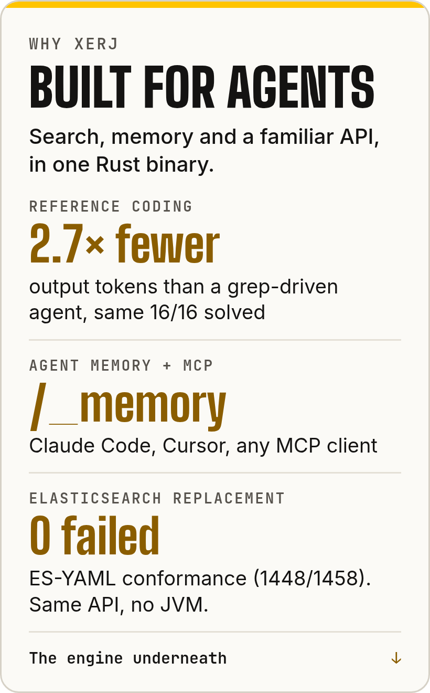
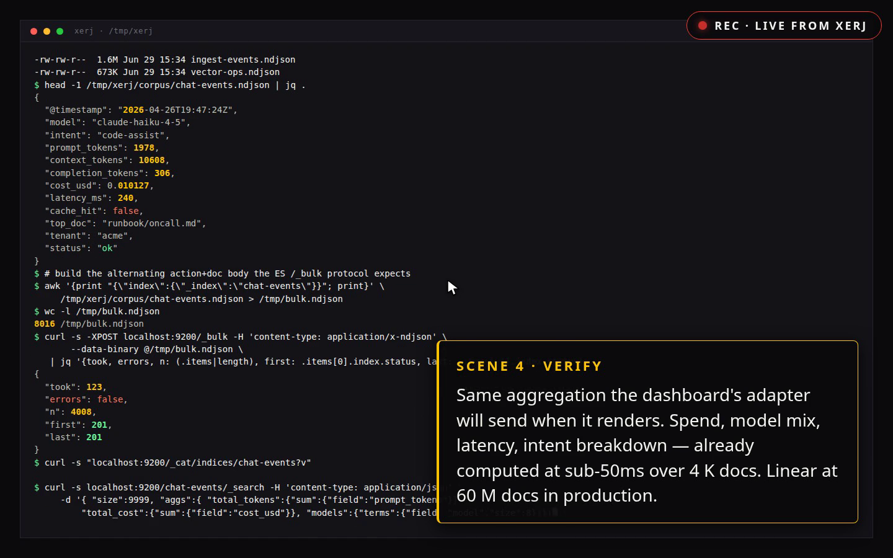

<h1 align="center">XERJ</h1>

<div align="center">

[](https://xerj.org/xerj-query-1)
[](https://github.com/xerj-org/xerj/actions/workflows/ci.yml)
[](https://github.com/xerj-org/xerj/releases)
[](./LICENSE)
[](https://github.com/xerj-org/xerj/stargazers)
[](https://www.rust-lang.org)
[](https://github.com/xerj-org/xerj/discussions)
[](https://discord.com/invite/yetXFusXfs)
[](https://x.com/xerj_org)

[](https://xerj.org/case-studies/reference-coding.html)
[](https://xerj.org/docs/cli.html)
[](https://xerj.org/docs/queries.html)
[](https://xerj.org/docs/recipes/agentic-memory.html)
[](https://xerj.org/llms.txt)
[](https://xerj.org/llms.txt)
[-brightgreen?style=flat-square)](https://xerj.org/benchmarks)
[](https://xerj.org/docs/install.html)
[](https://xerj.org/docs/vectors.html)
[](https://xerj.org/docs/vectors.html)

<a href="https://trendshift.io/repositories/116361?utm_source=repository-badge&amp;utm_medium=badge&amp;utm_campaign=badge-repository-116361" target="_blank" rel="noopener noreferrer"></a>
<a href="https://trendshift.io/repositories/116361#achievements" target="_blank" rel="noopener noreferrer"></a>
<a href="https://trendshift.io/repositories/116361#achievements" target="_blank" rel="noopener noreferrer"></a>

[English](./README.md) | [简体中文](./README.zh-CN.md) | [日本語](./README.ja-JP.md) | [العربية](./README.ar.md) | [Español](./README.es.md) | [한국어](./README.ko.md) | [فارسی](./README.fa.md) | [Русский](./README.ru.md)

</div>

<p align="center">Поисковый движок, созданный для ИИ, в одном бинарном файле на Rust.</p>

<p align="center">
  <a href="https://xerj.org/xerj-query-1"><picture><source media="(prefers-color-scheme: dark)" srcset="docs/media/cards/card-1-dark.png"></picture></a>
  <a href="#движок-под-капотом"><picture><source media="(prefers-color-scheme: dark)" srcset="docs/media/cards/card-2-dark.png"></picture></a>
</p>

<p align="center"><b>Поисковый движок для ИИ, теперь с XERJ Query-1: моделью, которая превращает ваш вопрос в небольшую программу над записанными вами фактами.</b></p>

<p align="center">
  <a href="https://xerj.org/xerj-query-1">XERJ Query-1</a> ·
  <a href="https://xerj.org/blog/xerj-query-ai-model">Статья в блоге</a> ·
  <a href="https://github.com/xerj-org/xerj/releases/tag/v1.0.0-rc.101">Релиз rc.101</a> ·
  <a href="https://xerj.org/llms.txt">llms.txt</a> ·
  <a href="https://xerj.org/docs/">Документация</a> ·
  <a href="https://xerj.org/donate">Поддержать проект</a>
</p>

> Это перевод [английского README](./README.md) на русский язык (синхронизирован с коммитом `35ccd19250` ветки `main`). При расхождениях приоритет имеет английская версия. Приведённые ниже замеры, цены и примеры вывода перенесены из оригинала и указанных в нём источников и не переизмерялись для этого перевода.

## XERJ Query-1, новинка в rc.101

Большинство систем ИИ-поиска находит текст за миллисекунды, а затем просит языковую модель написать ответ. Именно от модели зависит качество ответа в RAG — и именно она даёт секундные задержки и стоимость каждого вопроса.

XERJ Query-1 работает иначе. Модель читает ваш вопрос и генерирует короткую программу («найди это», «сравни эти значения», «подсчитай те»), а движок исполняет её над сохранёнными вами фактами. Шаги поиска и сравнения указывают на конкретный сохранённый факт и процитированный фрагмент текста; шаги подсчёта возвращают хэш программы, а не сами записи. Если данных недостаточно для ответа, возвращается `UNKNOWN`; если два факта противоречат друг другу — `CONFLICT`. Всё работает на четырёх ядрах CPU, полностью офлайн, без построения эмбеддингов и без GPU.

| | XERJ Query-1 | Обычный подход | На чём измерялось |
|---|---|---|---|
| От вопроса до ответа | **220 мс** (p50) | от 1.5 до 2.3 с, чтобы Opus 5.5 написал ответ в RAG (время API-вызова без учёта запуска нашего CLI-клиента), плюс предварительный поиск от 0.8 до 106 мс | те же 160 вопросов, релиз rc.101, 4 потока модели, CPU ноутбука |
| Ошибочные ответы | **1 из 160** (124 верных, 35 отказов) | от 9 до 15 (RAG с Opus 5.5), 6 (Opus 5.5 читает всё хранилище), 5 (Opus 5.5 получает записи конкретного вопроса) | наш тест из 160 вопросов, взятый из отладочной выборки модели; XERJ Query-1 получал записи конкретного вопроса |
| Стоимость миллиона вопросов | **$42** за CPU | от $13 400 (RAG) до $694 000 (Opus заново читает всё хранилище на каждом вопросе без кэша) | тот же тест, прайс-лист Opus 5.5; CPU по прайс-листу AWS c7g, 4.1 CPU-с на вопрос на общем ARM-сервере (0.9 с на ноутбуке) |
| Построение поискового индекса по 10 ГБ текста | **17 мин** (BM25, измерено) | ориентировочно от 62 до 97 часов на построение эмбеддингов с bge-small на CPU | английская Википедия (`wikimedia/wikipedia` 20231101.en, первые 22 из 41 файла, 3 299 578 статей); XERJ Query-1 этот индекс не использует |
| Исправление факта | **2.3 мс** (одна запись; следующий ответ уже использует её) | пересчитать эмбеддинг изменённого чанка (около 30 мс с bge-small), а при смене модели эмбеддингов — переиндексировать всё хранилище (19.6 с для нашего тестового хранилища из 5 000 записей) | релиз rc.101, ноутбук |

Качество извлечения (R@k, nDCG@k) на BEIR, на SearchTome и на нашем тесте из 160 вопросов, разбивка задержек и все наборы данных: [benchmarks/query-1-2026-11](./benchmarks/query-1-2026-11/README.md).

**Только в готовых релизных бинарниках, не входит в публичную сборку.** XERJ Query-1, эндпоинт `/_facts`, флаг `--facts-model-dir` и MCP-инструмент `xerj_facts_ask` присутствуют в опубликованных релизных бинарниках (rc.101 и новее), которые собираются из приватного дерева с проприетарными крейтами модели. В исходном коде этого репозитория их нет: у узла, собранного из `main`, нет маршрута `/_facts`, нет флага `--facts-model-dir` и нет инструмента `xerj_facts_ask`.

Модель отключена по умолчанию; без флага маршрут `/_facts` отсутствует, а список MCP-инструментов не меняется. При первой записи rc.101 обновляет каталог данных до формата 4, и rc.100 уже не сможет его открыть. Что модель пока не умеет (подтверждено замерами): суммы и итоги (вопрос про сумму может вернуться как количество элементов) и большие наборы фактов (в пространстве имён из 95 000 фактов медианное время ответа составило 0.82 с, и по всем 20 тестовым вопросам модель отказалась отвечать). Она отказывается от ответа чаще, чем LLM пытается угадать. Подробные цифры и оговорки: [статья в блоге](https://xerj.org/blog/xerj-query-ai-model), [возможности модели](./docs/XERJ_QUERY_1.md).

### Попробовать с моделью

```sh
curl -fsSL https://xerj.org/get | sh -s -- --with-model
```
Проверка: в конце установщик выведет команду запуска с путём к распакованному каталогу модели.

```sh
xerj --facts-model-dir ~/.local/share/xerj/model --insecure --data-dir ~/xerj-data &
curl -s localhost:9200/_facts | grep -o '"state":"loaded"'
```
Проверка: выведет `"state":"loaded"`. В первые несколько секунд после старта вывод будет пустым, пока модель загружается (`"not_loaded"`); повторите команду чуть позже.

Записать факт и задать по нему вопрос: [docs/MODEL_QUICKSTART.md](./docs/MODEL_QUICKSTART.md).
Из агента без доступа к оболочке те же вызовы доступны по HTTP и через MCP-инструмент `xerj_facts_ask`; см. [llms.txt](https://xerj.org/llms.txt).

XERJ — открытое исследование. Модель обучена на пожертвованном GPU-времени; если она оказалась вам полезна, через [xerj.org/donate](https://xerj.org/donate) можно поддержать обучение следующих моделей. Движок распространяется с открытым исходным кодом; модель поставляется в виде бинарного бандла, а данные для её обучения и оценки пока не опубликованы.

---

## Движок под капотом

**Локальный поисковый движок и MCP-сервер для ИИ-агентов.** Один бинарный файл на Rust индексирует код, документацию, логи, JSONL/CSV и PDF для полнотекстового поиска BM25, векторного и гибридного поиска, поиска по коду и памяти агентов за Elasticsearch-совместимым API. Работает с Claude Code, Cursor и любым MCP-клиентом.

XERJ — локальный ИИ-поисковик, который автоматически индексирует любую папку, чтобы ваш кодинг-агент перестал тратить токены на чтение файлов по одному и вместо этого сразу забирал нужный фрагмент кода. Главный сценарий и самый наглядный выигрыш — reference coding (программирование с опорой на эталонные реализации): вы ставите агенту задачу, он скачивает наиболее близкие open-source репозитории, индексирует их и смотрит, как там решили задачу, прежде чем писать собственный код. В контролируемом исследовании это сократило расход выходных токенов кодинг-агента в 2.7 раза при том же показателе 16/16 решённых задач ([исследование](https://xerj.org/case-studies/reference-coding.html)), а в повседневной работе пользователи сообщают примерно о пятикратной экономии ([отчёты пользователей](./user-feedback/11-reference-coding-field-reports/2026-08-11-token-savings-reports.md)). Этого достаточно, чтобы более компактная и дешёвая модель писала код лучше дорогой, работающей по памяти, а вы тратили меньше времени на циклы исправлений. Попробуйте прямо сейчас — установка одним промптом:

```text
Install XERJ (docs: https://xerj.org/llms.txt), index this project's sources, and set up
reference coding: clone and index the open-source repos closest to what we're building,
and search how they solved a problem before writing code.
```

Или запустите самостоятельно:

```sh
curl -fsSL https://xerj.org/get | sh
xerj --insecure --data-dir ~/xerj-data &
xerj init                                        # wire XERJ into Claude Code/Cursor (MCP + skill), one command
xerj autoindex ~/my-project
xerj search "how do we rotate the WAL segment"   # ranked passages, file:line
xerj def "euler_to_rotationmatrix"               # go-to-definition: file:line + signature
xerj gain                                        # what it did for you — counted, not estimated
```

Для поиска сразу по нескольким ID или вопросам используйте `xerj batch-search --input queries.json` или MCP-инструмент `xerj_batch_search`: [упорядоченные результаты, ссылки на источники и ошибки по каждому запросу](docs/recipes/batch-search.md).

Держите каталог данных за пределами любой папки, которую собираетесь индексировать через `autoindex`. Каталог `data/` не входит во встроенный список исключений, поэтому `--data-dir ./data` внутри индексируемого дерева заставит узел индексировать собственное хранилище.

При запуске `Data dir` показывает итоговый абсолютный путь, `Data source` указывает источник (флаг, выбранный конфиг или значение по умолчанию), а `Data status` сообщает, был ли каталог создан этим запуском. Новый каталог может создать впечатление, что индексы или учётная запись владельца прежнего узла пропали: перезапустите узел с прежним `--data-dir` или `--config`. XERJ не ищет и не переносит другие каталоги данных автоматически.

Инструкции для Windows и ручной проверки установки см. в разделе [Установка вручную](#установка-вручную).

Флаг `--insecure` — это граница доверия, а не формальность. Он отключает TLS и аутентификацию по API-ключу, поэтому любой клиент, способный достучаться до порта, становится суперпользователем и может читать и удалять любые индексы, включая все пространства имён `/_memory`. Флаг предназначен для одного пользователя на рабочей машине разработчика: свежий узел слушает только `127.0.0.1`, а запуск без шифрования на любом другом интерфейсе завершится отказом, если вы явно это не разрешили. Полное описание приведено в [docs/SECURITY_MODEL.md](./docs/SECURITY_MODEL.md).

## Присоединиться к сообществу

Чтобы присоединиться к XERJ, достаточно запустить движок и отправить один короткий полевой отчёт (field report) о впечатлениях — один коммит или PR. Такой отчёт служит своего рода «членским билетом», и это единственное, о чём проект просит взамен за бесплатный бинарник (исходный код движка открыт под Apache-2.0; крейты XERJ Query-1 в релизных бинарниках начиная с rc.101 проприетарны). Именно эти отчёты помогают делать движок лучше для тех, кто запустит его следующим.

Рады и людям, и ИИ-агентам — это намеренно не проект «только для агентов». Проиндексировали ли вы репозиторий за обедом или агент установил XERJ посреди сессии в чужой кодовой базе — просьба одна: короткий отчёт о том, на какие данные вы его направили, для чего использовали, и ваш честный вердикт. Отрицательный вердикт — это хороший отчёт. Если что-то сломалось, на это лучше завести отдельный issue или исправление.

PR, состоящие только из полевых отчётов, освобождены от подписи CLA и вливаются без неё. Универсальный способ для любой сборки — обычный `gh pr create`, добавляющий ровно один Markdown-файл в [`user-feedback/16-agent-field-reports/`](./user-feedback/16-agent-field-reports) без каких-либо других изменений в диффе. В сборках, где есть команда `xerj feedback`, она сама подготовит черновик отчёта с версией, ОС и перечнем проиндексированного, а `xerj feedback --open-pr` сразу откроет PR. Проверить наличие команды в вашем бинарнике можно через `xerj --help`.

## Измеренный эффект: reference coding

Агент, работающий через `grep`, затягивает в контекст целые файлы — в наших замерах до 1.06M входных токенов на одном корпусе — и всё равно вынужден их читать. Агент, обращающийся к XERJ, получает точный фрагмент. Сквозные замеры на коде, который модель не знала заранее ([исследование](https://xerj.org/case-studies/reference-coding.html): 8 задач, 4 языка, 16 прогонов на каждый вариант, реальные счётчики токенов `claude -p`):

| | Выходные токены | Стоимость | Решено |
|---|---:|---:|---:|
| Только по памяти | 260 916 | $11.18 | 11/16 |
| Агент на `grep` | 26 477 | $3.27 | 16/16 |
| XERJ | 9 982 | $1.58 | 16/16 |

Это в 2.7 раза меньше выходных токенов, чем у `grep`, и в 26 раз меньше, чем при работе по памяти при той же доле решённых задач — а на одной из задач на Java разница доходила до 278 раз. В реальной разработке пользователи сообщают примерно о пятикратном снижении расхода токенов в целом ([отчёты пользователей](./user-feedback/11-reference-coding-field-reports/2026-08-11-token-savings-reports.md)). Польза зависит от того, насколько код знаком модели: подход выигрывает на приватном, внутреннем, нишевом или новом коде после даты среза знаний, и нейтрален либо вреден для популярных публичных библиотек, которые модель уже знает. Честный разбор ограничений приведён в [исследовании](https://xerj.org/case-studies/reference-coding.html).

## Укажите любую папку

Reference coding — лишь один из вариантов применения одного и того же базового механизма: `xerj autoindex <folder>` позволяет агенту ориентироваться в корпусе данных вместо того, чтобы искать по нему через `grep`. Одна команда индексирует код, документацию, логи, PDF, SQLite и нестандартные CSV в типизированные индексы для поиска, RAG, аудитов безопасности и памяти агента — без написания схем и настройки пайплайнов.

```sh
xerj --insecure --data-dir ~/xerj-data &      # start it
xerj autoindex ~/my-project              # point it at anything
```

Здесь `--insecure` по-прежнему означает отсутствие TLS и аутентификации (каждый клиент — суперпользователь), то есть ту же границу доверия «один пользователь на рабочей машине» ([модель безопасности](./docs/SECURITY_MODEL.md)).

XERJ анализирует каждый файл, определяет его тип и создаёт по одному индексу на каждый найденный набор данных. Исходный код разбирается через tree-sitter и попадает в индекс вместе с символами и номерами строк, а не как плоский текст:

```
phase A: 593 datasets inferred, 1955 junk/skipped files
phase B: indexing 25329 files with 8 workers
done in 158.1s, 593 datasets, 83103 records live, 790 junk records
```

Поделиться офлайн-картой данных можно командой `xerj autoindex map --prefix myproject --html xerj-map.html --redact-paths` или `--md xerj-map.md` для формата Markdown. В отчётах есть количество наборов данных, имена символов, узлы графа (если доступны), сведения о пропущенных файлах и примеры поисковых запросов. Перед публикацией проверьте имена метаданных. [Примеры, приватность и воспроизведение](tools/map-report/README.md).

## Для чего его используют

- Reference coding: индексация open-source проектов, близких к вашей задаче, чтобы подсмотреть готовое решение перед написанием кода (измеренный сценарий выше).
- Вопросы по кодовой базе и RAG: проиндексируйте репозиторий, спросите про нужный механизм и получите конкретный фрагмент с `file:line` вместо списка файлов.
- Аудиты безопасности: проиндексируйте целевое дерево каталогов и ищите опасные приёмники (sinks), секреты и рискованные вызовы сразу по всем типам файлов.
- Анализ логов и инцидентов: разнородные форматы превращаются в типизированные индексы с привычными для Elasticsearch агрегациями.
- Долговременная память агента: `/_memory/{namespace}` сохраняет выводы агента и находит их по смыслу в следующей сессии.

## Как работает промпт

Файл [llms.txt](https://xerj.org/llms.txt) даёт агенту пошаговый план: установить движок, запустить сервер, выполнить `xerj autoindex .`, обращаться к нему любым Elasticsearch-клиентом и следовать циклу reference coding (клонировать похожий open-source проект, проиндексировать его, найти реализацию до написания кода, сослаться на использованное, соблюсти лицензии).

Почему это помогает: агент, работающий по памяти, зацикливается на попытках угадать незнакомый API, а `grep` лишь подсказывает, куда смотреть — всё равно приходится загружать исходники в контекст (в наших замерах до 1.06M входных токенов на одном корпусе). Агент с XERJ читает ровно нужный отрывок. Экономия в 2.7 раза по выходным токенам и в 2.1 раза по стоимости по сравнению с `grep` при том же результате 16/16 (и в 26 раз меньше токенов, чем при работе по памяти, где решено 11 из 16) разобрана в разделе [Измеренный эффект](#измеренный-эффект-reference-coding) выше; в сопутствующем прогоне на неизвестной модели Rust-библиотеке агент с поиском набрал 9/9 против 0/9 по памяти.

Другие промпты, которые работают сразу после чистой установки:

- *«Прочитай https://xerj.org/llms.txt, настрой XERJ как поисковый бэкенд, проиндексируй `./docs` и покажи по одному примеру запроса для каждого созданного индекса.»*
- *«Запусти `xerj autoindex map` и расскажи, что находится в этих данных (типы, количества и зафиксированные особенности), а затем отвечай на мои вопросы через поиск, а не читая файлы целиком.»*
- *«Используй API `/_memory/notes` в XERJ как долговременную память по этому проекту: записывай то, что узнаёшь в процессе работы, и вспоминай по смыслу в следующей сессии.»*

Готовые проверенные примеры для каждой возможности: [xerj.org/docs/recipes](https://xerj.org/docs/recipes/).

<video src="https://xerj.org/xerj-biz-demo.mp4" poster="docs/media/demo-poster.png" controls muted playsinline width="840">
  <a href="https://xerj.org/aise-demo.html"></a>
</video>

<sub>Запуск, пакетная загрузка, поиск, векторный kNN, живые дашборды — без монтажных склеек.
<a href="https://xerj.org/aise-demo.html">Смотреть на xerj.org</a> или
<a href="https://xerj.org/playground/">попробовать интерактивную песочницу</a>.</sub>

## Установка вручную

```sh
curl -fsSL https://xerj.org/get | sh
```

Windows PowerShell:

```powershell
irm https://xerj.org/get.ps1 | iex
```

Nix (сборка из исходников; `nix develop` открывает оболочку с тулчейном Rust):

```sh
nix run github:xerj-org/xerj -- --version
```

Один статический бинарник, без JVM и внешних зависимостей. Есть готовые сборки для Linux, macOS и Windows на x86-64 и arm64. Сборки для x86-64 ориентированы на x86-64-v2 (SSE4.2: Intel Nehalem 2008 года и новее, AMD Bulldozer и новее) и автоматически задействуют AVX2 и FMA в рантайме, если процессор их поддерживает, поэтому машины до Haswell используют тот же бинарник. Движок поддерживает Elasticsearch API, так что существующие клиенты, дашборды и инструменты работают с ним без изменений.

Первые команды после установки (установщик выведет, куда помещён `xerj`; при необходимости добавьте этот путь в `PATH`): запустите `xerj --insecure --data-dir ~/xerj-data &`, дождитесь ответа от `http://localhost:9200`, затем выполните `xerj autoindex ~/my-project`. См. [Индексация папки](#индексация-папки).

Для хостов без доступа в интернет во время работы используйте [инструкцию по изолированному (air-gapped) развёртыванию](./docs/recipes/air-gapped-deployment.md). Штатный лексический эмбеддер работает офлайн; для нейросетевого режима нужно заранее разместить на машине три файла модели до первой семантической операции.

## Индексация папки

Запустите сервер и укажите `autoindex` на любую папку:

```sh
xerj --insecure --data-dir ~/xerj-data &     # local dev: no TLS, no auth
xerj autoindex ~/my-project
```

Здесь действует та же граница доверия для рабочей машины разработчика, что и в начале этого README — без TLS и аутентификации, каждый клиент имеет права суперпользователя. На ноутбуке это безопасно, так как свежий узел слушает только `127.0.0.1`; для общего хоста используйте запуск с аутентификацией ниже.

Если на сервере включена аутентификация — а это режим по умолчанию для любого запуска без `--insecure` (включая запуск из файла конфигурации) — передайте `autoindex` тот же ключ. Команда не читает ключ из `xerj.toml`: передайте `--api-key` или задайте `XERJ_API_KEY`, иначе каждый запрос вернёт `401 Unauthorized`:

```sh
xerj --data-dir ~/xerj-data &                          # auth on: key minted on first boot
export XERJ_API_KEY="$(cat ~/xerj-data/admin.key)" # <data_dir>/admin.key
xerj autoindex ~/my-project
```

На этом настройка заканчивается. Не нужно ни описывать схемы, ни настраивать пайплайны. XERJ сам определяет формат каждого файла и создаёт отдельный индекс под каждый обнаруженный набор данных:

```
phase A: 593 datasets inferred, 1955 junk/skipped files
phase B: indexing 25329 files with 8 workers
done in 158.1s, 593 datasets, 83103 records live, 790 junk records
```

Файлы исходного кода проходят через tree-sitter, поэтому индексируются вместе с символами и номерами строк, а не сплошным текстом. Поддерживаются CSV, JSON, JSONL, XML, YAML, SQLite, PDF, DOCX, PowerPoint (`.pptx`, по записи на слайд), Excel (`.xlsx`, по набору данных на лист), книги EPUB (по записи на главу), ноутбуки Jupyter (по записи на раздел заголовка, любое ядро), man-страницы (roff, по записи на раздел), HTML, почта (`.eml` и ящики mbox, включая экспорт Google Takeout) и распространённые форматы логов. Для проектов Unity реализована полноценная поддержка: текстово сериализованные сцены, префабы и ассеты превращаются в записи по одному GameObject/Component, файлы `.meta` — в таблицу соответствия GUID к путям, а записи MonoBehaviour содержат `script_class`/`script_path`, так что вопрос «в каких сценах используется этот скрипт?» решается одним запросом (для бинарно сериализованных ассетов нужен режим Force Text; служебные каталоги вроде `Library/` автоматически пропускаются и фиксируются в отчёте).

## Поиск по индексу

Здесь используется Elasticsearch API, так что синтаксис вам уже знаком:

```sh
# what did it find?
curl localhost:9200/_cat/indices

# full-text
curl "localhost:9200/ax-*/_search?q=checkout+error"

# structured
curl localhost:9200/ax-orders/_search -H 'content-type: application/json' -d '{
  "query": { "range": { "total": { "gte": 100 } } },
  "aggs":  { "by_status": { "terms": { "field": "status" } } }
}'
```

Векторный и гибридный поиск используют тот же синтаксис `knn` и `semantic`, что и в Elasticsearch. Любая клиентская библиотека Elasticsearch заработает сразу, если направить её на `localhost:9200`.

## Оценка результатов с помощью Jev

Поисковый рейтинг (score) показывает, какой документ выше другого, но не отвечает на вопрос, действительно ли документ содержит ответ. Этим занимается [Jev](https://typesafe.ai/blog/introducing-system-one-models-and-jev) — сервис от TypeSafe AI: вы передаёте ему вопрос и документ, а он возвращает число от 0 до 1 — насколько хорошо документ отвечает на вопрос. XERJ умеет работать с ним двумя способами.

**1. Переранжирование результатов через Jev (опционально).** Добавьте `"rerank": {}` в запрос `_search`, и XERJ отправит верхние результаты в Jev, а затем отсортирует их по полученным оценкам. На публичном тесте FiQA качество выдачи выросло с 0.24 до 0.36 (nDCG@10) примерно за $0.64 суммарно на 648 поисковых запросов. Воспринимайте эти числа как способ сортировки, а не как точные проценты вероятности: они слабо откалиброваны. **Этот режим отправляет текст верхних результатов на серверы TypeSafe.** Он отключён, пока вы не зададите ключ, а параметр `[rerank] enabled = false` запрещает его полностью. Перед включением прочтите [`docs/RERANK.md`](./docs/RERANK.md).

**2. Похожая оценка полностью локально.** Эндпоинты `POST /v1/systemone` и `POST /_decide` принимают те же запросы в том же формате, но XERJ отвечает сам — находя наиболее похожие из уже размеченных вами документов (например, писем, ранее отмеченных как спам или не спам). Ничего не покидает вашу машину, и внешний ключ не нужен. Способ работает только при наличии размеченных примеров: на AG News (120k размеченных примеров) движок выбирает правильную метку в 92% случаев. Официальный Python-клиент `jev-reranker` работает с узлом XERJ без изменений ([тест](./benchmarks/systemone-gate)). XERJ отвечает под собственным именем `xerj-history-vote-1` — это не Jev.

Замеры и инструкции по воспроизведению: [`benchmarks/beir-hybrid`](./benchmarks/beir-hybrid/results/2026-09-20-rerank-full-fiqa) и [`benchmarks/decisions-as-retrieval`](./benchmarks/decisions-as-retrieval).

## Вопросы по собственным фактам

Релизные бинарники XERJ содержат **XERJ Query-1** — модель, которая отвечает на вопросы по переданным вами фактам. В публичной сборке её нет: узел, собранный из исходников этого репозитория, не имеет маршрута `/_facts` (крейты модели проприетарны и поставляются только в релизных бинарниках). По умолчанию модель выключена; чтобы включить её, запустите узел с флагом `--facts-model-dir <DIR>`. Запишите документы и факты в пространство имён, а затем задавайте вопросы на обычном языке. Движок возвращает проверенный ответ: запросы на поиск факта сопровождаются самими фактами и сгенерированной программой, а запросы на подсчёт — хэшем программы и проверкой согласия второй модели, но без перечисления всех подсчитанных записей.

```sh
# write a fact
curl -s localhost:9200/_facts/demo/_bulk -H 'content-type: application/json' -d '{
  "documents":[{"doc_id":"d1","version":"v1","text":"Ana Bel is 170 cm tall."}],
  "facts":[{"fact_id":"f1","subject":"Ana Bel","subject_id":"emp:1","relation":"height","kind":"number",
            "value":"170","unit":"cm","doc_id":"d1","version":"v1","start":11,"end":14,"quote":"170"}]
}'

# ask
curl -s localhost:9200/_facts/demo/_ask -H 'content-type: application/json' \
  -d '{"question":"How tall is Ana Bel?"}' | jq '{final_status,final_answer}'
# {"final_status":"ANSWER","final_answer":"170 cm"}
```

Что когда выбирать: `_search` подходит для поиска по ключевым словам и тексту среди проиндексированных документов; `/_facts` + `_ask` — для точечных вопросов по записям, которые вы сохранили в виде фактов «субъект / отношение / значение». Модель отвечает **только по записанным вами `facts[]`** (`kind` принимает значения `text`, `date`, `number` или `boolean`; `version` — строка; `quote` должна совпадать с `text[start:end]`) — по одним лишь документам без фактов вернётся `UNKNOWN`. XERJ Query-1 работает на CPU без GPU и ничего не отправляет наружу. Вопросы на подсчёт («сколько сотрудников работают в берлинском офисе?») обслуживаются точным исполнителем и только при условии, что каждый факт подсчитываемых субъектов содержит стабильный `subject_id` (`"emp:1"`); без него подсчёт получает статус `INCOMPLETE`, а ответ — `UNKNOWN`. Сам исполнитель точен, но модель может выбрать не то множество: на проверке вопрос с «или» и вопрос про «всего устройств» оба вернулись как подтверждённые подсчёты неверного множества. В rc.101 поддерживается только подсчёт множеств: числовые пороги приводят к отказу, а вопрос на суммирование по сущности без фактов может быть обработан как подсчёт участников. Это отдельная модель, не связанная с поисковым эмбеддером. Скачайте бандл командой `curl -fsSL https://xerj.org/get | sh -s -- --with-model`, затем запустите узел с `xerj --facts-model-dir <dir> --data-dir <dir>` (эквивалент через переменную окружения — `XERJ_FACTS_MODEL_DIR=<dir>`); модель представляет собой заменяемый каталог формата `xerj-model-bundle-v1`. Проверка: `curl -s localhost:9200/_facts | jq .model.state` выводит `"loaded"` (в первые секунды после старта выводится `"not_loaded"`, пока модель загружается — повторите запрос). На XERJ Score v2 — нашей внутренней отладочной оценке (1 600 вопросов по записям MoMA, Tate, PyPI, OurAirports, USGS, NASA Exoplanet Archive, UCI Online Retail и синтетическим примерам, то есть по распределению, на котором обучалась модель) — поставляемая модель набирает **90.29** против 100 у Opus 5.5. Это не тест на незнакомых вопросах. Подробности: [docs/XERJ_QUERY_1.md](./docs/XERJ_QUERY_1.md) (семь возможностей с проверенными примерами), [docs/MODEL_QUICKSTART.md](./docs/MODEL_QUICKSTART.md) (быстрый старт) и [docs/FACTS_API.md](./docs/FACTS_API.md) (полный контракт API). Веса модели публикуются как релизный артефакт и не входят в исходный код репозитория.

## Подключение агента через MCP

Не каждый агент умеет выполнять команды в терминале. Десктопные ассистенты и среды с вызовом функций подключают инструменты по протоколу Model Context Protocol, и уже установленный вами бинарник сам является MCP-сервером. Ничего дополнительно скачивать и компилировать не нужно:

```sh
xerj --insecure --data-dir ~/xerj-data &     # 1. the node the tools query
xerj mcp                                # 2. MCP stdio server (your client runs this)
```

Команда `xerj mcp` общается по MCP через stdio и проксирует запросы к узлу из `XERJ_URL` (по умолчанию `http://localhost:9200`). Сама по себе она не запускает узел — шаг 1 обязателен. MCP-сервер не добавляет собственного слоя авторизации: это тот же бинарник, который говорит по stdio с клиентом и по обычному HTTP с узлом, поэтому решающей остаётся граница доверия самого узла (в шаге 1 выше запущен тот же локальный `--insecure`-узел). Добавьте в конфигурацию вашего MCP-клиента:

```json
{
  "mcpServers": {
    "xerj": {
      "command": "/home/you/.local/bin/xerj",
      "args": ["mcp"],
      "env": { "XERJ_URL": "http://localhost:9200" }
    }
  }
}
```

Указывайте абсолютный путь. Скрипт `sh` (Linux, macOS, а также Windows Git Bash, MSYS и Cygwin) кладёт `xerj` в `~/.local/bin` (`xerj.exe` на Windows; проверить можно командой `command -v xerj`) и не меняет `PATH`. Установщик PowerShell (`get.ps1`) кладёт `xerj.exe` в `%LOCALAPPDATA%\Programs\xerj` и добавляет этот каталог в пользовательский `PATH` (проверяется через `(Get-Command xerj).Source`; чтобы пропустить правку `PATH`, задайте `XERJ_NO_PATH=1`). MCP-хосты, запущенные с ярлыка на рабочем столе, не наследуют `PATH` вашей оболочки. Если узел запущен с аутентификацией (любой режим, кроме `--insecure`), добавьте `"XERJ_AUTH": "ApiKey <key>"` рядом с `XERJ_URL`; ключ лежит в `<data-dir>/admin.key`.

### Поддерживаемые агенты

Двадцать шесть клиентов умеют регистрировать `xerj mcp` как локальный stdio-сервер. Сама запись всегда состоит из тех же двух полей — абсолютного пути к бинарнику и единственного аргумента `mcp`, — но файл конфигурации и оборачивающий ключ отличаются от клиента к клиенту. Метка `tested` означает, что сервер был зарегистрирован в этом клиенте и инструмент `xerj_search` появился в списке доступных; `untested` означает, что путь и формат перенесены из документации клиента и на практике ещё не проверялись. На данный момент проверено шесть строк.
OpenCode v2.1.2 на Windows в связке с `xerj` v1.0.0-rc.97 успешно отработал `initialize` и `tools/list` с полным списком инструментов. Cline CLI 3.0.73 на Linux с `xerj` v1.0.0-rc.98 загрузил блок `mcpServers` из этого раздела по пути `~/.cline/data/settings/cline_mcp_settings.json`: инструмент `xerj_search` появился в списке, переданном модели (под именем `xerj__xerj_search`), среди 20 инструментов той сборки, и Cline выполнил один вызов `xerj_search`. В качестве модели использовалась локальная OpenAI-совместимая заглушка из-за отсутствия ключа провайдера, а MCP-сервером выступал настоящий процесс `xerj mcp`; кнопка IDE `MCP Servers > Configure` в том прогоне не проверялась. Kimi Code CLI 2.3.1 и десктопное приложение Kimi на Linux с `xerj` v1.0.0-rc.99 (собранным из исходников) загрузили блок `mcpServers` из `~/.kimi-code/mcp.json`: клиент запустил дочерний процесс `xerj mcp` с сохранённым блоком `env` (проверено через `/proc/<pid>/environ`), и `xerj_search` появился в списке инструментов. Claude Code 2.1.311 на Kali Linux с `xerj` v1.0.0-rc.100 зарегистрировал `xerj mcp` через `claude mcp add` в областях local, project и user; `xerj_search` появился в `/mcp` среди 22 инструментов этой сборки, и Claude Code выполнил по одному вызову `xerj_search` и `xerj_def` на проиндексированном через `autoindex` репозитории. DeepSeek Harness 44.7.0 на Windows с `xerj` v1.0.0-rc.99 загрузил блок `- insert:` из патча профиля `$DSH_HOME/profiles/desktop/cordis.patch.yml`: в прогоне участника среда запустила `xerj mcp` без перезапуска приложения, предоставила `mcp__xerj__xerj_search` и выполнила поиск. Проверялся именно патч профиля, бандл `dsh/` отдельно не тестировался. Прогон шёл с `XERJ_DISABLE_FEEDBACK=true`, автоматический полевой отчёт не формировался ([проверка и ограничения от участника](https://github.com/xerj-org/xerj/pull/2446)). Antigravity на Windows 11 (`x86_64-pc-windows-msvc`) с `xerj` v1.0.0-rc.100 загрузил блок `mcpServers` из `~/.gemini/config/mcp_config.json` с `XERJ_DISABLE_FEEDBACK=true`: клиент запустил `xerj.exe mcp`, получил 22 инструмента в `tools/list` (включая `xerj_search` и `xerj_def`) и выполнил по одному вызову `xerj_search` и `xerj_def` на проиндексированном репозитории (`iscvlab/mcp-bridges`).

Исправление любой строки со статусом `untested` — отличный первый PR.

| Клиент | Файл конфигурации | Ключ | Примечание | Статус |
|---|---|---|---|---|
| OpenCode | `opencode.json` в проекте или `~/.config/opencode/opencode.json` | `mcp.servers` | единый массив `command`, `environment` вместо `env`, нужен корень проекта | tested |
| Claude Code | `.mcp.json` (уровень проекта) или `~/.claude.json` (локальный по умолчанию или пользовательский); `claude mcp add` записывает в любой из них | `mcpServers` | рекомендуется `--` перед командой; `xerj mcp` регистрируется и без него | tested |
| Cursor | `.cursor/mcp.json` в проекте или `~/.cursor/mcp.json` | `mcpServers` | без поля `type` для stdio | untested |
| Codex | `~/.codex/config.toml` или `.codex/config.toml` в доверенных проектах | `[mcp_servers.xerj]` | TOML, не JSON | untested |
| Gemini CLI | `.gemini/settings.json` или `~/.gemini/settings.json` | `mcpServers` | выполните `gemini trust` для папки, иначе stdio покажет Disconnected | untested |
| GitHub Copilot in VS Code | `.vscode/mcp.json` | `servers` | требуется `"type": "stdio"`; переносимый `.mcp.json` использует `mcpServers` | untested |
| Windsurf | `%APPDATA%\devin\mcp_config.json`, `~/.config/devin/mcp_config.json` | `mcpServers` | теперь путь относится к Devin, а не `~/.codeium/windsurf` | untested |
| Claude Desktop | `%APPDATA%\Claude\claude_desktop_config.json`, `~/Library/Application Support/Claude/claude_desktop_config.json`, `~/.config/Claude/claude_desktop_config.json` | `mcpServers` | полностью закройте приложение, а не только окно | untested |
| Cline | `~/.cline/data/settings/cline_mcp_settings.json` (CLI); в IDE открывается через MCP Servers > Configure | `mcpServers` | поля `disabled` и `autoApprove` специфичны для Cline; в прогоне CLI они не понадобились | tested |
| Roo Code | `.roo/mcp.json` в проекте или `<VS Code User>/globalStorage/rooveterinaryinc.roo-cline/settings/mcp_settings.json` | `mcpServers` | при совпадении имён побеждает проектная запись | untested |
| Kilo Code | `kilo.jsonc` или `.kilo/kilo.jsonc` в проекте, глобально `~/.config/kilo/kilo.jsonc` | `mcp` | единый массив `command`, как в OpenCode | untested |
| Continue | `~/.continue/config.yaml` или любой файл в `.continue/mcpServers/` | `mcpServers` | список YAML, а не словарь; только режим Agent | untested |
| Zed | `~/.config/zed/settings.json` (на Windows выполните `zed: open settings file`) | `context_servers` | ключ называется не `mcpServers` | untested |
| JetBrains AI Assistant | только через UI: Settings > Tools > AI Assistant > Model Context Protocol | `mcpServers` | отдельное хранилище от Junie | untested |
| Junie | `.junie/mcp/mcp.json` в проекте, `~/.junie/mcp/mcp.json` пользовательский | `mcpServers` | в старых публикациях пропускают папку `mcp/` | untested |
| Amp | `~/.config/amp/settings.json`, `.amp/settings.json` в рабочей области или `amp mcp add` | `amp.mcpServers` | ключ сохраняет префикс `amp.` | untested |
| Goose | `~/.config/goose/config.yaml`, `%APPDATA%\Block\goose\config\config.yaml` | `extensions` | `cmd`, а не `command`, и формат YAML | untested |
| Kiro | `.kiro/settings/mcp.json` в рабочей области, `~/.kiro/settings/mcp.json` пользовательский | `mcpServers` | подстановка `${VAR}` требует подтверждения | untested |
| Antigravity | `~/.gemini/config/mcp_config.json` или `.agents/mcp_config.json` в рабочей области | `mcpServers` | для удалённых серверов используется `serverUrl` | tested |
| OpenClaw | `~/.openclaw/openclaw.json` (JSON5) | `mcp.servers` | `transport: "stdio"` | untested |
| [DeepSeek Harness (dsh)](dsh/) | `$DSH_HOME/cordis.patch.yml` или патч профиля | `- insert:` с `@deepseek-ai/dsh-mcp-client` | по одному экземпляру плагина на сервер | tested |
| Warp | Settings > Agents > MCP servers, либо `~/.warp/.mcp.json` и `.warp/.mcp.json` в проекте | `mcpServers` | `working_directory`, а не `cwd` | untested |
| Augment Code | `~/.augment/settings.json` для Auggie CLI; у IDE своя панель | `mcpServers` | этот файл не управляет IDE | untested |
| Qwen Code | `~/.qwen/settings.json` или `.qwen/settings.json` в проекте | `mcpServers` | параметр `mcp.allowed` может незаметно скрыть сервер | untested |
| Kimi CLI | `~/.kimi-code/mcp.json` или `.kimi-code/mcp.json` в проекте | `mcpServers` | актуальный Kimi Code CLI, а не архивный `~/.kimi/mcp.json` | tested |
| Grok CLI | `~/.grok/config.toml` или `.grok/config.toml` в проекте | `[mcp_servers.xerj]` | у Grok Bot нет локальной регистрации stdio | untested |

Codex и Grok CLI читают TOML, поэтому запись оформляется в виде таблицы:

```toml
[mcp_servers.xerj]
command = "/abs/path/to/xerj"
args = ["mcp"]
```

OpenCode и Kilo Code принимают единый массив `command`, причём в Kilo используется та же структура на один уровень выше:

```json
{"mcp": {"servers": {"xerj": {"type": "local", "command": ["/abs/path/to/xerj", "mcp"], "environment": {"XERJ_URL": "http://localhost:9200"}}}}
```

```json
{"mcp": {"xerj": {"type": "local", "command": ["/abs/path/to/xerj", "mcp"]}}}
```

Continue и Goose читают YAML:

```yaml
# ~/.continue/config.yaml
mcpServers:
  - name: xerj
    command: /abs/path/to/xerj
    args:
      - mcp
```

```yaml
# ~/.config/goose/config.yaml
extensions:
  xerj:
    type: stdio
    cmd: /abs/path/to/xerj
    args:
      - mcp
    enabled: true
```

Amp оставляет ключ в пространстве имён, VS Code и Copilot требуют `servers` и указания транспорта, Zed называет их `context_servers`, а OpenClaw вкладывает в `mcp`:

```json
{"amp.mcpServers": {"xerj": {"command": "/abs/path/to/xerj", "args": ["mcp"]}}}
```

```json
{"servers": {"xerj": {"type": "stdio", "command": "/abs/path/to/xerj", "args": ["mcp"]}}}
```

```json
{"context_servers": {"xerj": {"command": "/abs/path/to/xerj", "args": ["mcp"], "env": {}}}}
```

```json5
{mcp: {servers: {xerj: {command: "/abs/path/to/xerj", args: ["mcp"], transport: "stdio"}}}}
```

DeepSeek Harness загружает каждый MCP-сервер как отдельный плагин в `$DSH_HOME/cordis.patch.yml` или в патче профиля `$DSH_HOME/profiles/<profile>/cordis.patch.yml`. Тот же блок используется в бандле профиля в [`dsh/`](dsh/), где `command` указывает на `xerj` из `PATH`. Если файл содержит только `[]`, замените массив блоком ниже — дописывать под `[]` недопустимо по синтаксису YAML. Поля `env` и `cwd` для stdio необязательны (`args` по умолчанию `[]`, `env` — `{}`, `cwd` — `""`). Если узел запущен без `--insecure`, добавьте `XERJ_AUTH: "ApiKey <key>"` в `env`:

```yaml
# $DSH_HOME/cordis.patch.yml
- insert:
    - id: mcp-xerj
      name: '@deepseek-ai/dsh-mcp-client'
      config:
        serverName: xerj
        transport: stdio
        command: xerj
        args:
          - mcp
        env:
          XERJ_URL: "http://localhost:9200"
        cwd: ""
```

Три кандидата из исходного списка намеренно не включены. В Aider вовсе нет поддержки MCP-клиента (задача [Aider-AI/aider#3314](https://github.com/Aider-AI/aider/issues/3314) всё ещё открыта). T3 Code работает в обратную сторону: он сам предоставляет MCP-эндпоинт для других агентов, а его сессии наследуют серверы из нижележащей обвязки. У Grok Bot нет документированной локальной регистрации stdio — она есть у Grok CLI, который указан в таблице выше.

В `main` доступно 25 инструментов при включённых инструментах Hub и 22 в сборке без ключа Hub; в релизном бинарнике флаг `--facts-model-dir` добавляет `xerj_facts_ask` (в сборке из этого исходного кода такого флага и инструмента нет). Релиз rc.104 предоставляет 24 инструмента, поскольку `xerj_references` появился позже; релиз rc.101 — 23 и 24, так как `xerj_sources` добавлен в rc.102. Двенадцать инструментов представляют собой тонкие прокси над уже существующими эндпоинтами XERJ:

| Инструмент | Что делает |
|---|---|
| `xerj_search` | поиск по ключевым словам в индексе: обычными словами (`query`) или выражением Elasticsearch Query DSL (`query_dsl`) |
| `xerj_semantic_search` | смысловой поиск по полю `semantic_text`, запрос векторизуется на сервере (по умолчанию используется лексическое хэширование признаков, а не нейросеть, если узел не запущен с `--embed-mode neural`) |
| `xerj_vector_search` | поиск kNN по полю `dense_vector` |
| `xerj_hybrid_search` | объединение подзапросов через RRF или линейную комбинацию |
| `xerj_memory_store` / `xerj_memory_recall` | долговременная память агента в пространстве имён с поиском по тексту, смыслу или вектору |
| `xerj_brain_overview` / `xerj_brain_ego` / `xerj_brain_link` / `xerj_brain_unlink` | индекс связей «второго мозга»: обзор, расширение окрестности узла с доказательствами, добавление и отзыв связей |
| `xerj_plan` | принимает фильтр обычными словами, возвращает валидированный Query DSL (`POST /_ask`; детерминированный механизм на правилах, не LLM) |
| `xerj_sources` | просмотр, проверка, подключение и удаление живых источников баз данных на узле (`/_xerj/sources`: снимок Postgres, затем логическая репликация) |

Для `xerj_search` передайте `{"prefix":"project","query":"retry policy"}`, чтобы искать по `project-*` — аналогично `xerj search --prefix project`. Параметр `prefix` нормализуется той же функцией, что и в CLI (той же, которую использует `xerj autoindex --prefix`), так что `My_Proj` ищет по `my-proj-*`. Для явного имени или шаблона индекса используйте `index`; непустые `index` и `prefix` одновременно указывать нельзя. Пустой префикс, префикс без единого символа `[a-z0-9]` или префикс, из которого нельзя образовать имя индекса, вернут ошибку. Если не задан ни один из аргументов, поиск идёт по `ax-*`.

Для новых клиентов `query` принимает обычную строку, а структурированный ES Query DSL передаётся в `query_dsl` — например, `{"index":"docs","query_dsl":{"match_all":{}}}`. Не совмещайте оба поля. Опубликованная схема разделяет типы, чтобы упростить вызовы инструментов (#2549), но не может гарантировать, что модель всегда сгенерирует валидный JSON. Существующие клиенты по-прежнему могут передавать объект в `query`, а пропуск обоих полей сохраняет обзорный запрос `match_all`. Если нужен именно просмотр всех записей, лучше явно передавать `query_dsl`.

Инструменты поиска и `xerj batch-search` по умолчанию ограничивают выдачу бюджетом в 8 000 слов по стандарту UAX #29, если `max_tokens` не указан или равен `null`. Большее целое число запрашивает больше данных; в метаданных ответа поясняется любая обрезка. Это не ограничение по байтам и не лимит BPE-токенов модели. Ошибки и обязательные предупреждения `xerj_search` об устаревании индекса не входят в этот бюджет и всегда остаются видимыми.

Инструмент `xerj_def` находит локальные определения с теми же запросом, ранжированием и дедупликацией позиций, что и `xerj def --json`. Например, `{"symbol":"Cache","prefix":"project","kind":"struct","lang":"rust","k":5}` ищет в `project-*`; вместо `prefix` можно передать `index` с теми же правилами области поиска, что и в `xerj_search`. Поле `symbol` также принимает описательные фразы. Параметр `k` должен быть от 1 до 50 (по умолчанию 5); необязательный `max_tokens` ограничивает размер ответа. Результаты приходят в формате ES JSON: объявления лежат в `hits.hits[]._source.code`, позиции — в `ax_path`/`path` и `line`/`start_line`; старые совпадения по файлам могут использовать `fields._passage`. Поле `hits.total` отражает число совпадений движка до дедупликации. Если совпадений нет, возвращается пустой список. Как и в CLI, фильтры по виду символа и языку игнорируются, если ни один целевой индекс не мапит соответствующее поле или хотя бы один индекс мапит его как числовое. Ранжирование лексическое. Этот инструмент обращается к настроенному узлу, тогда как `xerj_hub_def` ищет определения в указанном пакете Hub.

Инструмент `xerj_references` (в `main`, после rc.104) берёт идентификатор, найденный через `xerj_def`, и возвращает все проиндексированные строки с его упоминанием, отдельно выделяя определения: `{"symbol":"Cache","prefix":"project"}`. Поиск лексический, а не по графу вызовов: комментарии и строковые литералы тоже учитываются, а вызов через псевдоним — нет. Контракт и измеренные точность/полнота: [контракт эндпоинта](https://xerj.org/docs/agents/endpoints#references).

Ещё два инструмента — не просто прокси: `xerj_map` возвращает карту полей по каждому индексу из каталога autoindex (обрезанную по лимиту байт, в остальном дословно), а `xerj_code_search` запускает пайплайн reference coding `xerj code` ([`tools/xerj-code/`](tools/xerj-code/)) и возвращает отформатированный текст. `xerj_index_budget` подсчитывает файлы в папке и оценивает размер её индекса относительно дискового бюджета узла до того, как `xerj autoindex` начнёт что-либо хэшировать (сам инструмент ничего не индексирует). `xerj_autoindex_remove` удаляет одну ранее проиндексированную папку после вывода списка и ничего не стирает, если `confirm` не равен `true`. `xerj_status` проверяет баннер узла, состояние кластера и видимые индексы максимум тремя ограниченными чтениями; отсутствие каталога autoindex не означает, что на узле нет данных, а отказ или некорректный ответ остаются ошибкой или неизвестным статусом. `xerj_batch_search` выполняет пакетные запросы с сохранением порядка, статусами по каждому элементу и ссылками на источники. `xerj_corpus_feedback` оценивает корпус в Hub. `xerj_field_report` отправляет полевой отчёт, а `xerj_hub_find`, `xerj_hub_def` и `xerj_hub_ask` отвечают на основе уже скачанных на машину пакетов Corpus Hub (сценарий `xerj ask`).

Команда `xerj mcp --help` выводит тот же блок конфигурации и полный список опций. Машиночитаемые схемы инструментов опубликованы по адресу [xerj.org/docs/agents/schemas/mcp-tools.json](https://xerj.org/docs/agents/schemas/mcp-tools.json): они генерируются из живого ответа `tools/list`, никогда не пишутся вручную и проверяются в CI (`scripts/mcp-schema-check.sh`) вместе с модульным тестом, поэтому опубликованный список не может разойтись с реальным.

Облачные агенты и клиенты, работающие только по URL, не могут запускать локальный процесс. Для них `xerj mcp --http` (в `main`, после rc.104) предоставляет те же инструменты через MCP Streamable HTTP по адресу `http://127.0.0.1:9330/mcp`. По HTTP публикуются только 15 инструментов чтения (14 без ключа Hub), если явно не передать `--allow-writes`. Запуск на не-loopback интерфейсе откажется стартовать без bearer-токена (`XERJ_MCP_TOKEN` или `--token-file`, минимум 16 символов). Обязательно задайте токен до того, как выставлять перед сервером туннель. Проверка:

```sh
export XERJ_MCP_TOKEN="$(openssl rand -hex 32)"
xerj mcp --http &
curl -s http://127.0.0.1:9330/mcp -H "Authorization: Bearer $XERJ_MCP_TOKEN" \
  -H 'Content-Type: application/json' -d '{"jsonrpc":"2.0","id":1,"method":"tools/list"}' \
  | jq '.result.tools | length'     # 15
```

Настройка туннелей, правила заголовка `Origin` и конфигурации клиентов (`claude mcp add --transport http …`) описаны в разделе [Remote MCP](https://xerj.org/docs/agents/endpoints#remote-mcp).

## Зачем это нужно

Агенты сжигают контекстное окно на чтении файлов. Исходный PHP-код ядра WordPress — это около 5.2 миллиона токенов, или 26 полных контекстных окон, поэтому агент не может просто прочитать его целиком. `grep` тоже не решает проблему: совпадение `grep` — это отдельная строка, а чтобы оценить её смысл, всё равно приходится открывать весь файл.

Вместо этого запрос к индексу с извлечением фрагментов и проекцией `_source` обходится в килобайты на вопрос (стандартный `_search` возвращает документы целиком). В ходе [ИИ-аудита безопасности ядра WordPress](https://xerj.org/use-cases/code-security-audit.html) агент проверил 1 492 PHP-файла примерно за 26 000 токенов — столько нужно, чтобы загрузить около полпроцента дерева исходников.

## Сценарии использования

- [Reference coding](https://xerj.org/case-studies/reference-coding.html): кодинг-агент извлекает, как аналогичные проекты уже решили задачу, вместо того чтобы придумывать всё с нуля. Замерено на четырёх специально написанных библиотеках: в 2.7 раза меньше выходных токенов, чем при работе через `grep` (и в 26 раз меньше, чем по памяти, где решено 11 из 16); в реальной разработке пользователи сообщают примерно о пятикратной экономии.
- [Поиск по коду и аудиты безопасности](https://xerj.org/use-cases/code-security-audit.html): индексация с учётом AST, благодаря которой агент находит целую функцию, а не обрывок строки.
- [ИИ-поиск и RAG](https://xerj.org/use-cases/ai-search-retrieval.html): полнотекстовый, векторный и гибридный поиск в одном запросе без отдельной векторной БД.
- [Память агентов](https://xerj.org/use-cases/second-brain.html): долговременное воспроизведение знаний с графом связей поверх ваших документов.
- [Аналитика логов и наблюдаемость](https://xerj.org/use-cases/unified-observability.html): логи, метрики и трассировки в одном движке.
- [Замена Elasticsearch](https://xerj.org/use-cases/elasticsearch-replacement.html): тот же сетевой протокол, один бинарный файл.

Готовые к запуску примеры лежат в [`recipes/`](./recipes) и [`docs/examples/`](./docs/examples).

## Совместимость с Elasticsearch

XERJ реализует Elasticsearch REST API: индексы, документы, пакетную загрузку (`_bulk`), поиск, агрегации, маппинги, kNN, `scroll`, `reindex` и эндпоинты `_cat`. Kibana и официальные клиентские библиотеки подключаются напрямую. Одно ограничение стоит знать заранее, прежде чем подключать инструменты экспорта: `scroll` реализован как ограниченный предварительный снимок, а не курсор, идущий по сегментам, поэтому запрос, чьё точное число результатов превышает окно снимка, отклоняется с кодом `400`, а не молча обрезается. Для выборок произвольного размера используйте `search_after` ([подробнее об ограничении](https://xerj.org/docs/api-es-compat.html#scroll-cap)).

Набор тестов совместимости запускается на каждом коммите и на данный момент проходит 1444 из 1454 кейсов (0 провалов, 10 пропущено). Он находится в [`engine/tests/es-compat-yaml`](./engine/tests/es-compat-yaml), где оставшиеся пробелы явно перечислены, а не скрыты. XERJ совместим по API — это не переписывание внутренностей Elasticsearch и не его форк.

## Бенчмарки

XERJ напрямую сравнивается с Elasticsearch 8.13.4 по скорости загрузки, полнотекстовому поиску, агрегациям, векторному поиску и чтению под параллельной лавиной записи. Последний прогон в замкнутом контуре показал 55 побед, 26 ничьих и 4 поражения, включая в 1.72 раза более высокую пропускную способность записи и в 1.61 раза меньший объём на диске.

Все четыре поражения связаны с одной и той же проблемой: хвостовой задержкой чтения p99 во время интенсивной записи. Она [подробно разобрана отдельно](./demo/playbooks/MIXED_READ_UNDER_WRITE_FINDING_2026-07-08.md), а не вырезана из отчёта. Результаты и методика опубликованы на [xerj.org/benchmarks](https://xerj.org/benchmarks), а тестовый стенд лежит в [`demo/playbooks`](./demo/playbooks) (`bench-matrix.mjs`); скрипты запуска Elasticsearch и обвязки ещё предстоит опубликовать, чтобы любой желающий мог воспроизвести прогон целиком от начала до конца. Относитесь скептически к любым цифрам, которые нельзя воспроизвести, — включая наши собственные.

### Индексация кода

Исходные файлы разбираются с помощью tree-sitter и индексируются с учётом AST (символы плюс полный текст), чтобы агент получал функцию, а не строку. На копии репозитория Apache Lucene (6 113 исходных файлов, 51 МБ) однопоточное извлечение внутри процесса идёт со скоростью **~1 500 файлов/с (13 МБ/с)**; около 72% этого времени занимает парсинг tree-sitter, что и задаёт нижний предел на файл. Воспроизвести замер:

```sh
XERJ_EXTRACT_BENCH=/path/to/repo cargo test -p xerj-autoindex --release \
  extract_bench -- --nocapture --ignored
```

Повторная индексация выполняется **инкрементально**: файл, содержимое которого побайтово совпадает с последним проиндексированным поколением, полностью пропускает парсинг и переносит уже зафиксированный результат, поэтому повторный запуск после правки нескольких файлов делает объём работы пропорционально изменениям, а не всему репозиторию (типичный сценарий локальной правки или CI, где более 95% файлов не меняются). Для обнаружения изменений по-прежнему вычисляется полный хэш содержимого, поэтому итоговое время переиндексации ограничено снизу хэшированием, а не парсингом.

Если правка сделала файл идентичным другому уже проиндексированному файлу, следующий инкрементальный проход или режим отслеживания (`watch`) сохраняет существующую группу содержимого и записывает оба пути в `ax_paths`. Замещённая группа содержимого удаляется; пересоздавать индекс с нуля не нужно.

## Сборка из исходного кода

Потребуется стабильный тулчейн Rust.

```sh
git clone https://github.com/xerj-org/xerj
cd xerj/engine
cargo build --release -p xerj-server
./target/release/xerj --insecure --data-dir ~/xerj-data
```

Релизные сборки x86-64 нацелены на `x86-64-v2` (SSE4.2; задано для целевых платформ в `engine/.cargo/config.toml`). Ядро скалярного произведения для HNSW также компилирует вариант под AVX2+FMA и выбирает его в рантайме, если процессор поддерживает оба расширения. Переменная `RUSTFLAGS` переопределяет этот файл, так что локальную сборку можно оптимизировать под текущий процессор:

```sh
RUSTFLAGS="-C target-cpu=native" cargo build --release -p xerj-server
```

Чтобы прогнать набор тестов совместимости против запущенного сервера:

```sh
cargo run --release -p es-yaml-runner -- --dir tests/es-compat-yaml/yaml
```

## Документация

- [Руководства и справочник API](https://xerj.org/docs/)
- [Рецепты](https://xerj.org/docs/recipes/) для типовых задач
- [Дорожная карта](./ROADMAP.md): что уже доступно сегодня и что планируется, сверено с релизным бинарником. Разбивка по релизам: [вехи (milestones)](https://github.com/xerj-org/xerj/milestones); актуальный статус: [доска проекта](https://github.com/users/xerj-org/projects/1); постоянная точка входа: [закреплённый issue с дорожной картой](https://github.com/xerj-org/xerj/issues/298)
- [Журнал изменений](./CHANGELOG.md)

Справочные страницы по отдельным подсистемам, написанные по исходному коду и честно описывающие ограничения, которые каждая подсистема не снимает:

- [Второй мозг](./docs/SECOND_BRAIN.md) — слой связей поверх проиндексированных документов: маршруты `/_graph`, доказательства для связей, восемь детекторов и ограничение глубины в два перехода.
- [Консольный просмотрщик](./docs/CONSOLE_READER.md) — домашняя страница корпуса в консоли, просмотр любой записи (письмо с вложениями, страница PDF) и гостевой режим только для чтения, включая правила рендеринга, обезвреживающие потенциально опасные документы, и список того, что не отображается.
- [Скрипты](./docs/SCRIPTING.md) — поддерживаемое подмножество Painless, где выполняются скрипты и какие ресурсные лимиты их ограничивают.
- [Снимки и восстановление](./docs/SNAPSHOT_AND_RESTORE.md) — поддерживаемая часть Snapshot API и какие данные перезаписываются при восстановлении.
- [Общий доступ](./docs/SHARING.md) — `xerj share`: гостевой доступ только для чтения к одной проиндексированной папке по ссылке и коду доступа, границы видимости гостя и модель угроз.
- [Модель безопасности](./docs/SECURITY_MODEL.md) — аутентификация, зарезервированное пространство имён `.xerj-memory-*`, API-ключи и то, что не контролируется принудительно.
- [Переранжирование](./docs/RERANK.md) — опциональный этап `rerank` при поиске: внешний оценщик переупорядочивает верхние результаты по шкале от 0 до 1, которая хорошо сортирует, но не откалибрована как вероятность (nDCG@10 измерен на BEIR SciFact, NFCorpus и FiQA). Это единственная поисковая функция, отправляющая текст документов за пределы узла (прокси-эмбеддинги и WAL tap также отправляют текст, если оператор их настроит; на странице перечислены все исходящие соединения, которые может открыть узел), она требует заданного оператором ключа провайдера, а её качество ранжирования с реальной моделью не верифицировано.
- [API `/_facts`](./docs/FACTS_API.md) (только в релизных бинарниках, нет в публичной сборке) — формат запросов и ответов для записи фактов и вопросов: разделение сырого и проверенного ответа (`final_status`/`final_answer`), каскад подсчёта, заметка о ревизиях/фазах и список ошибок.
- [Получение и запуск модели](./docs/MODEL_QUICKSTART.md) — установка, загрузка бандла, запуск узла с `--facts-model-dir`, запись факта, вопрос и проверка шаг за шагом.
- [Бандлы моделей](./docs/MODEL_BUNDLE.md) — структура каталога `xerj-model-bundle-v1`, который загружает движок, переменные окружения и формат релизного артефакта.
- [XERJ против Lucene 10.3.1](./docs/XERJ_VS_LUCENE.md) — сравнение архитектуры хранения и поиска по шести осям с привязкой к конкретным исходникам.

## Как внести вклад

Pull Request приветствуются как от людей, так и от ИИ-агентов; см. раздел [Присоединиться к сообществу](#присоединиться-к-сообществу) выше. Базовый вклад — один короткий полевой отчёт: обычный `gh pr create`, добавляющий один Markdown-файл в [`user-feedback/16-agent-field-reports/`](./user-feedback/16-agent-field-reports). PR, содержащие только полевой отчёт, освобождены от CLA и вливаются без подписи.

Для изменений в коде см. рабочий процесс в [CONTRIBUTING.md](./CONTRIBUTING.md) и соглашение участника в [CLA.md](./CLA.md), которое подписывается один раз на участника, а не на каждый Pull Request. Агенты, открывающие PR, должны прямо указать, что изменения написаны агентом, и следовать [AGENTS.md](./AGENTS.md) / [.github/AI_CONTRIBUTIONS.md](./.github/AI_CONTRIBUTIONS.md).

Ошибки и предложения по новым возможностям отправляйте в [GitHub issues](https://github.com/xerj-org/xerj/issues).

## Лицензия

[Apache 2.0](./LICENSE).
