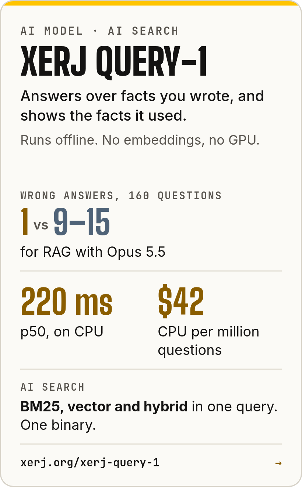
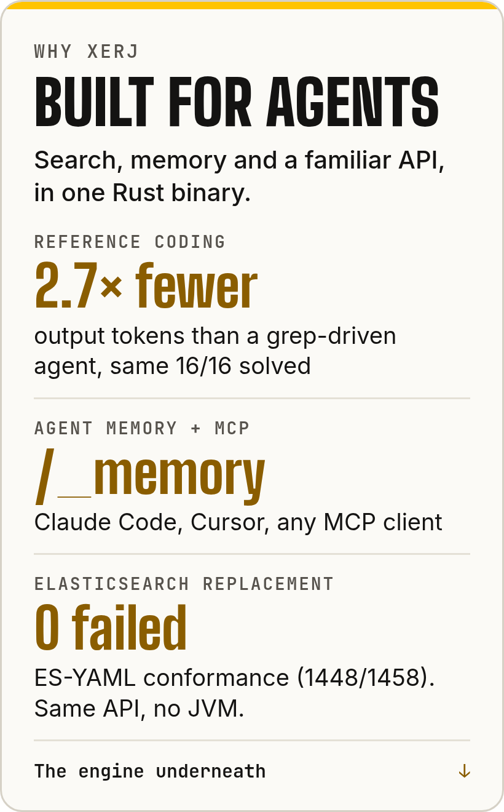
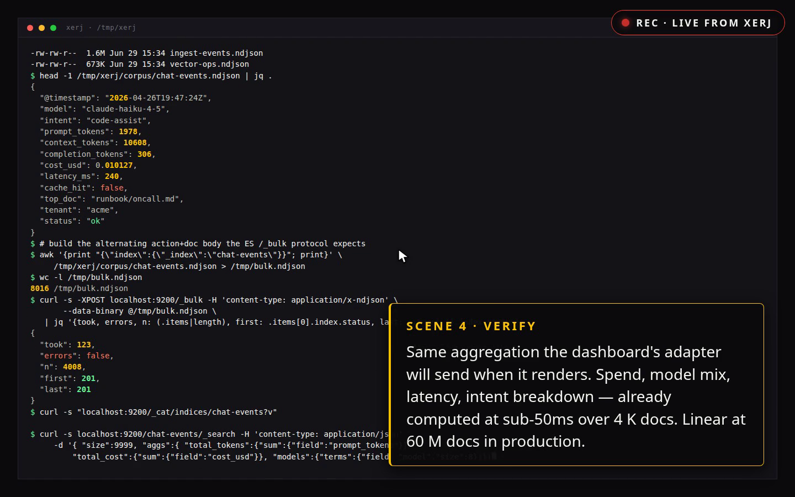

<h1 align="center">XERJ</h1>

<div align="center">

[](https://xerj.org/xerj-query-1)
[](https://github.com/xerj-org/xerj/actions/workflows/ci.yml)
[](https://github.com/xerj-org/xerj/releases)
[](./LICENSE)
[](https://github.com/xerj-org/xerj/stargazers)
[](https://www.rust-lang.org)
[](https://github.com/xerj-org/xerj/discussions)
[](https://discord.com/invite/yetXFusXfs)
[](https://x.com/xerj_org)

[](https://xerj.org/case-studies/reference-coding.html)
[](https://xerj.org/docs/cli.html)
[](https://xerj.org/docs/queries.html)
[](https://xerj.org/docs/recipes/agentic-memory.html)
[](https://xerj.org/llms.txt)
[](https://xerj.org/llms.txt)
[-brightgreen?style=flat-square)](https://xerj.org/benchmarks)
[](https://xerj.org/docs/install.html)
[](https://xerj.org/docs/vectors.html)
[](https://xerj.org/docs/vectors.html)

<a href="https://trendshift.io/repositories/116361?utm_source=repository-badge&amp;utm_medium=badge&amp;utm_campaign=badge-repository-116361" target="_blank" rel="noopener noreferrer"></a>
<a href="https://trendshift.io/repositories/116361#achievements" target="_blank" rel="noopener noreferrer"></a>
<a href="https://trendshift.io/repositories/116361#achievements" target="_blank" rel="noopener noreferrer"></a>

[English](./README.md) | [简体中文](./README.zh-CN.md) | [日本語](./README.ja-JP.md) | [العربية](./README.ar.md) | [Español](./README.es.md) | [한국어](./README.ko.md) | [فارسی](./README.fa.md) | [Türkçe](./README.tr.md)

</div>

<p align="center">Yapay zekâ için tasarlanmış arama motoru, tek bir Rust çalıştırılabilir dosyasında.</p>

<p align="center">
  <a href="https://xerj.org/xerj-query-1"><picture><source media="(prefers-color-scheme: dark)" srcset="docs/media/cards/card-1-dark.png"></picture></a>
  <a href="#the-engine-underneath"><picture><source media="(prefers-color-scheme: dark)" srcset="docs/media/cards/card-2-dark.png"></picture></a>
</p>

<p align="center"><b>Yapay zekâ için arama motoru: XERJ Query-1, sorunuzu kaydettiğiniz olgular üzerinde çalışan küçük bir programa dönüştürür.</b></p>

<p align="center">
  <a href="https://xerj.org/xerj-query-1">XERJ Query-1</a> ·
  <a href="https://xerj.org/blog/xerj-query-ai-model">Blog yazısı</a> ·
  <a href="https://github.com/xerj-org/xerj/releases/tag/v1.0.0-rc.101">rc.101 sürümü</a> ·
  <a href="https://xerj.org/llms.txt">llms.txt</a> ·
  <a href="https://xerj.org/docs/">Belgeler</a> ·
  <a href="https://xerj.org/donate">Bağış yapın</a>
</p>

## rc.101 ile gelen XERJ Query-1

Çoğu yapay zekâ arama sistemi metni milisaniyeler içinde bulur, ardından yanıtı yazmayı bir dil modeline bırakır. RAG yanıtının kalitesini model belirler; saniyeler süren beklemenin ve soru başına maliyetin kaynağı da odur.

XERJ Query-1 farklı çalışır. Sorunuzu okuyup kısa bir program yazar: şu kaydı bul, bunları karşılaştır, şunları say. Motor bu programı kaydettiğiniz olgular üzerinde çalıştırır. Arama ve karşılaştırma adımları, dayandıkları kaydı ve alıntılanan bölümü gösterir. Sayım işlemleri ise kayıtların kendisini değil, programın özet değerini döndürür. Veriler yanıt vermeye yetmiyorsa `UNKNOWN`, iki olgu çelişiyorsa `CONFLICT` sonucunu alırsınız. Dört CPU çekirdeğiyle çevrimdışı çalışır; vektör temsilleri oluşturmanız veya GPU kullanmanız gerekmez.

| Ölçüt | XERJ Query-1 | Alışılmış yöntem | Ölçüm koşulları |
|---|---|---|---|
| Sorudan yanıta geçen süre | **220 ms** (p50) | 0,8–106 ms süren aramanın ardından Opus 5.5’in RAG yanıtını yazması 1,5–2,3 sn (çağrı başına API süresi; komut satırı istemcisinin açılışı hariç) | Aynı 160 soru, rc.101, model için 4 iş parçacığı, dizüstü bilgisayar işlemcisi |
| Yanlış yanıt | **160 soruda 1** (124 doğru, 35 yanıtsız) | Opus 5.5 ile RAG: 9–15; Opus 5.5 tüm kayıtları okuduğunda: 6; Opus 5.5’e yalnız soruyla ilgili kayıtlar verildiğinde: 5 | Modelin geliştirme kümesinden seçilen 160 soru; XERJ Query-1’e de her sorunun ilgili kayıtları verildi |
| Bir milyon sorunun maliyeti | **42 ABD doları** (CPU) | 13.400 ABD doları (RAG) ile 694.000 ABD doları (Opus her soruda tüm kayıtları önbelleksiz yeniden okuduğunda) arasında | Aynı test, Opus 5.5 ve AWS c7g liste fiyatları; soru başına paylaşımlı ARM sunucusunda 4,1 CPU-saniye, dizüstünde 0,9 |
| 10 GB metni indeksleme | **17 dk** (BM25, ölçülen) | CPU üzerinde bge-small ile vektör temsillerini çıkarmak tahminen 62–97 saat | İngilizce Vikipedi (`wikimedia/wikipedia` 20231101.en, 41 dosyanın ilk 22’si, 3.299.578 madde); XERJ Query-1 bu indeksi kullanmaz |
| Bir olguyu düzeltme | **2,3 ms** (tek yazma; sonraki yanıt düzeltilmiş bilgiyi kullanır) | Değişen parçanın vektörü yeniden hesaplanır (bge-small ile yaklaşık 30 ms); model değişirse tüm kayıtlar yeniden işlenir (5.000 kayıtlık testte 19,6 sn) | rc.101, dizüstü bilgisayar |

BEIR, SearchTome ve 160 soruluk testte erişim kalitesi (R@k, nDCG@k), gecikmenin aşamalara dağılımı ve tüm veri kümeleri: [ölçüm sonuçları](./benchmarks/query-1-2026-11/README.md).

**Yalnızca yayımlanan hazır paketlerde bulunur.** XERJ Query-1, `/_facts`, `--facts-model-dir` ve `xerj_facts_ask` MCP aracı, rc.101 ve sonraki sürümlerin hazır çalıştırılabilir dosyalarında vardır. Bu dosyalar, kapalı kaynak model paketlerini de içeren özel bir kaynak ağacından derlenir. Bu deponun `main` dalından derlenen düğümde `/_facts` uç noktası, `--facts-model-dir` seçeneği ve `xerj_facts_ask` aracı yoktur.

Model varsayılan olarak kapalıdır. İlgili seçeneği vermezseniz `/_facts` uç noktası açılmaz ve MCP araç listesi değişmez. **rc.101 ilk yazmada veri dizinini biçim 4’e yükseltir; rc.100 bu dizini artık açamaz.** Ölçümlerde görülen sınırlamalar: Toplam sorularında değerlerin toplamı yerine öğe sayısı dönebilir. 95.000 olguluk bir ad alanında ortanca sorgu süresi 0,82 saniyeydi ve 20 test sorusunun tamamı yanıtsız kaldı. Bir dil modelinin tahminde bulunacağı durumlarda Query-1 daha sık yanıt vermekten kaçınır. Rakamlar ve geçerlilik koşulları: [blog yazısı](https://xerj.org/blog/xerj-query-ai-model), [modelin yetenekleri](./docs/XERJ_QUERY_1.md).

### Modelle deneyin

```sh
curl -fsSL https://xerj.org/get | sh -s -- --with-model
```

Kontrol: Kurulumun sonunda, paketten çıkarılan model dizinini içeren başlatma komutu görüntülenir.

```sh
xerj --facts-model-dir ~/.local/share/xerj/model --insecure --data-dir ~/xerj-data &
curl -s localhost:9200/_facts | grep -o '"state":"loaded"'
```

Kontrol: Çıktıda `"state":"loaded"` görünmelidir. Başlangıçta model hâlâ yükleniyorsa (`"not_loaded"`) ilk birkaç saniye çıktı alamazsınız; komutu yeniden çalıştırın.

Bir olgu kaydedip hakkında soru sormak için [model başlangıç kılavuzuna](./docs/MODEL_QUICKSTART.md) bakın. Kabuk erişimi olmayan ajanlar aynı çağrıları HTTP ve `xerj_facts_ask` MCP aracı üzerinden yapabilir; bkz. [llms.txt](https://xerj.org/llms.txt).

XERJ araştırmasını açık yürütür. Model, bağışlanan GPU süresiyle eğitildi. Yararlı bulduysanız [xerj.org/donate](https://xerj.org/donate) üzerinden sonraki modellerin eğitimine destek olabilirsiniz. Motor açık kaynaklıdır; model derlenmiş paket olarak dağıtılır. Eğitim ve değerlendirme verileri henüz kamuya açık değildir.

---

<a id="the-engine-underneath"></a>

## Arka plandaki arama motoru

**Yapay zekâ ajanları için yerel öncelikli arama motoru ve MCP sunucusu.** Tek bir Rust programı; kodu, belgeleri, günlükleri, JSONL/CSV ve PDF dosyalarını indeksler. Elasticsearch uyumlu API üzerinden BM25 tam metin araması, vektör araması, hibrit arama, kod araması ve ajan belleği sunar. Claude Code, Cursor ve tüm MCP istemcileriyle çalışır.

XERJ herhangi bir klasörü otomatik indeksler. Böylece kodlama ajanınız dosyaları tek tek okuyarak token harcamak yerine doğrudan gereken kodu alır. En belirgin kazanım referansla kodlamadadır: Ajan benzer açık kaynak depolarını indirip indeksler ve kendi kodunu yazmadan önce o projelerin aynı sorunu nasıl çözdüğüne bakar. [Kontrollü çalışmada](https://xerj.org/case-studies/reference-coding.html) ajan yine 16 görevin 16’sını çözerken çıktı için 2,7 kat daha az token kullandı. [Saha raporlarında](./user-feedback/11-reference-coding-field-reports/2026-08-11-token-savings-reports.md) günlük geliştirmede yaklaşık 5 kat azalma bildiriliyor. Bu sayede küçük ve ucuz bir model, yalnızca öğrendiklerine dayanan pahalı bir modeli geçebilir; düzeltmelerle daha az vakit kaybedersiniz. Kurulumu tek bir istemle deneyin:

```text
XERJ’yi kur (belgeler: https://xerj.org/llms.txt), bu projenin kaynaklarını indeksle ve referansla kodlamayı yapılandır: geliştirdiğimiz projeye en yakın açık kaynak depolarını klonlayıp indeksle. Kod yazmadan önce benzer bir sorunu nasıl çözdüklerini ara.
```

Ya da kendiniz çalıştırın:

```sh
curl -fsSL https://xerj.org/get | sh
xerj --insecure --data-dir ~/xerj-data &
xerj init                                        # wire XERJ into Claude Code/Cursor (MCP + skill), one command
xerj autoindex ~/my-project
xerj search "how do we rotate the WAL segment"   # ranked passages, file:line
xerj def "euler_to_rotationmatrix"               # go-to-definition: file:line + signature
xerj gain                                        # what it did for you — counted, not estimated
```

Birden fazla kimliği veya soruyu birlikte sorgulamak için `xerj batch-search --input queries.json` ya da `xerj_batch_search` MCP aracını kullanın: [sıralı sonuçlar, kaynaklar ve öğe bazında hatalar](docs/recipes/batch-search.md).

Veri dizinini otomatik indeksleyeceğiniz klasörlerin dışında tutun. `data/` yerleşik hariç tutma listesinde değildir. İndeksleyeceğiniz ağacın içinde `--data-dir ./data` kullanırsanız düğüm kendi depolama alanını da indeksler.

Başlangıçta `Data dir` veri dizininin tam yolunu, `Data source` bu yolun hangi seçenekten, yapılandırma dosyasından veya varsayılandan geldiğini, `Data status` ise dizinin bu çalıştırmada oluşturulup oluşturulmadığını gösterir. Yeni bir dizin kullanırsanız eski indeksleriniz veya sahip hesabınız kaybolmuş gibi görünebilir. Önceki `--data-dir` veya `--config` değeriyle yeniden başlatın. XERJ diğer veri dizinlerini kendiliğinden bulmaz veya taşımaz.

Windows ve kurulumu elle doğrulama adımları için [Elle kurulum](#install-by-hand) bölümüne bakın.

`--insecure` kullanıldığında TLS ve API anahtarıyla kimlik doğrulama kapanır. Porta ulaşabilen herkes süper kullanıcı olur; tüm `/_memory` ad alanları dahil her indeksi okuyabilir ve silebilir. Bu seçenek tek kullanıcılı geliştirme makineleri içindir. Yeni düğüm yalnızca `127.0.0.1` üzerinde dinler; açıkça izin verilmedikçe başka bir ağ arayüzünde şifresiz bağlantıyla başlamaz. Ayrıntılar: [güvenlik modeli](./docs/SECURITY_MODEL.md).

<a id="join-the-community"></a>

## Topluluğa katılın

XERJ’yi çalıştırıp deneyiminizi tek bir commit veya PR ile kısa bir saha raporu olarak paylaşarak topluluğa katılabilirsiniz. Bu rapor üyelik kartınızdır: Projenin ücretsiz çalıştırılabilir dosya karşılığında istediği tek şey budur. Motorun kaynak kodu Apache-2.0 lisanslıdır; rc.101’den itibaren hazır sürümlerde yer alan XERJ Query-1 paketleri ise kapalı kaynaklıdır. Raporunuz bir sonraki kullanıcının deneyimini iyileştirir.

İnsanlar ve yapay zekâ ajanları katkı sunabilir. İster öğle arasında bir depoyu indekslemiş olun ister bir ajan başka bir projede çalışırken XERJ’yi kurmuş olsun, beklenti aynı: Neyi indekslediniz, ne için kullandınız ve nasıl bir sonuç aldınız? Olumsuz deneyim de değerli bir rapordur. Bir şey bozulduysa ayrıca hata kaydı veya düzeltme gönderebilirsiniz.

Yalnızca saha raporu içeren PR’lar katkı sözleşmesinden (CLA) muaftır ve imzasız birleştirilebilir. Her derlemede geçerli yöntem, [`user-feedback/16-agent-field-reports/`](./user-feedback/16-agent-field-reports) altına tam bir Markdown dosyası ekleyip başka değişiklik yapmadan `gh pr create` çalıştırmaktır. Desteklenen sürümlerde `xerj feedback` sürümü, işletim sistemini ve neyin indekslendiğini içeren bir taslak hazırlar; `xerj feedback --open-pr` PR’ı açar. Komutun sürümünüzde bulunup bulunmadığını `xerj --help` ile kontrol edin.

<a id="the-measured-reason-reference-coding"></a>

## Referansla kodlama neden işe yarıyor?

grep kullanan bir ajan dosyaların tamamını bağlamına alır ve okur; ölçümlerimizde tek bir derlem için 1,06 milyon girdi tokenına kadar çıktı. XERJ’ye sorgu gönderen ajan ise yalnızca ilgili bölümü alır. Aşağıdaki [uçtan uca ölçümde](https://xerj.org/case-studies/reference-coding.html) modelin ezberlemediği kod kullanıldı: 8 görev, 4 dil, yöntem başına 16 çalıştırma ve `claude -p` tarafından bildirilen gerçek token sayıları.

| Yöntem | Çıktı tokenı | Maliyet | Çözülen görev |
|---|---:|---:|---:|
| Yalnız model belleği | 260.916 | 11,18 ABD doları | 11/16 |
| grep kullanan ajan | 26.477 | 3,27 ABD doları | 16/16 |
| XERJ | 9.982 | 1,58 ABD doları | 16/16 |

Aynı 16/16 başarıyla grep’e göre 2,7 kat daha az çıktı tokenı kullanıldı. Yalnız model belleğine göre fark 26 kat; tek bir Java görevinde 278 kata kadar çıkıyor. [Saha raporlarında](./user-feedback/11-reference-coding-field-reports/2026-08-11-token-savings-reports.md) günlük geliştirmede baştan sona yaklaşık 5 kat daha az token kullanıldığı bildiriliyor. Kazanım modelin kodu önceden tanıyıp tanımamasına bağlı: Özel, kurum içi, az bilinen veya eğitimden sonra yayımlanan kodda işe yarıyor; modelin zaten bildiği popüler kütüphanelerde yarar sağlamayabilir, hatta sonucu kötüleştirebilir. Sınırlar [vaka çalışmasında](https://xerj.org/case-studies/reference-coding.html) açıklanıyor.

## İstediğiniz klasörü indeksleyin

Referansla kodlama bunun yalnızca bir kullanım biçimi. `xerj autoindex <folder>` ile ajan bir derlemi grep ile taramak yerine sorgulayabilir. Kod, belgeler, günlükler, PDF, SQLite ve düzensiz CSV dosyaları tek komutla türleri belirlenmiş indekslere dönüşür. Arama, RAG, güvenlik denetimleri ve ajan belleği için şema yazmanız veya veri işleme hattı kurmanız gerekmez.

```sh
xerj --insecure --data-dir ~/xerj-data &      # start it
xerj autoindex ~/my-project              # point it at anything
```

Burada da `--insecure` TLS’yi ve kimlik doğrulamayı kapatır; her istemci süper kullanıcıdır. Örnek yalnızca tek kullanıcılı geliştirme makinesi içindir ([güvenlik modeli](./docs/SECURITY_MODEL.md)).

XERJ dosyaların içeriğinden türlerini belirler ve bulduğu her veri kümesi için bir indeks oluşturur. tree-sitter sayesinde kod, düz metnin yanında sembolleri ve satır numaralarıyla gelir:

```
phase A: 593 datasets inferred, 1955 junk/skipped files
phase B: indexing 25329 files with 8 workers
done in 158.1s, 593 datasets, 83103 records live, 790 junk records
```

`xerj autoindex map --prefix myproject --html
xerj-map.html --redact-paths` ile çevrimdışı bir veri haritası paylaşabilir veya Markdown çıktısı için `--md xerj-map.md` kullanabilirsiniz. Raporda veri kümesi sayıları, sembol adları, varsa grafiğin merkezi düğümleri, atlanan dosyalar ve önerilen aramalar bulunur. Paylaşmadan önce üst verilerdeki adları gözden geçirin. [Örnekler, gizlilik kapsamı ve aynı sonucu elde etme adımları](tools/map-report/README.md).

## Neleri indeksleyebilirsiniz?

- Referansla kodlama: Benzer açık kaynak projelerini indeksleyip kod yazmadan önce aynı sorunu nasıl çözdüklerine bakın. Yukarıdaki ölçüm bu kullanıma aittir.
- Kod tabanında soru-cevap ve RAG: Depoyu indeksleyip bir mekanizmanın nasıl çalıştığını sorun; klasör listesi yerine `file:line` bilgisiyle ilgili bölümü alın.
- Güvenlik denetimleri: Proje ağacını indeksleyip tüm dosya türlerinde hassas veri alan işlemleri, sızmış gizli bilgileri ve tehlikeli çağrıları birlikte arayın.
- Günlük ve olay analizi: Farklı biçimlerdeki günlükleri Elasticsearch’te kullandığınız toplulaştırmaları destekleyen türlendirilmiş indekslere dönüştürün.
- Kalıcı ajan belleği: `/_memory/{namespace}` ajanın öğrendiklerini saklar ve sonraki oturumda anlama göre geri getirir.

## İstem nasıl çalışır?

[llms.txt](https://xerj.org/llms.txt) adımları sırayla verir: Kurulum, sunucuyu başlatma, `xerj autoindex .`, herhangi bir Elasticsearch istemcisiyle sorgulama ve referansla kodlama. Benzer açık kaynak projelerini klonlayıp indeksleyin; kendi kodunuzu yazmadan önce çözümün nasıl çalıştığını bulun, kullandığınız kaynağı belirtin ve lisansına uyun.

Yalnızca öğrendiklerine dayanan bir ajan tanımadığı API’lerde deneme yanılmaya döner. grep nerede arayacağını söyler ama kaynak dosyalarını yine bağlama alması gerekir; bir derlemde 1,06 milyon girdi tokenına kadar ölçtük. XERJ ile doğrudan ilgili bölümü okur. [Yukarıdaki ölçümde](#the-measured-reason-reference-coding) aynı 16/16 başarıyla grep’e göre 2,7 kat daha az çıktı tokenı ve 2,1 kat daha düşük maliyet görüldü. Yalnız model belleğine göre 26 kat daha az token kullanıldı (model tek başına 16 görevin 11’ini çözdü). Modelin hiç görmediği bir Rust kütüphanesinde yapılan ek denemede sonuç, aramayla 9/9, yalnız bellekle 0/9 oldu.

Yeni bir kurulum için başka örnek istemler:

- “https://xerj.org/llms.txt dosyasını oku, arama için XERJ’yi kur, `./docs` konumunu indeksle ve oluşturulan her indeks için bir örnek sorgu göster.”
- “`xerj autoindex map` çalıştır. Verinin türlerini, kayıt sayılarını ve saptanan sorunları anlat. Ardından dosyaları okumak yerine arama yaparak sorularımı yanıtla.”
- “Bu proje için uzun süreli bellek olarak XERJ’nin `/_memory/notes` API’sini kullan. Çalışırken öğrendiklerini kaydet ve sonraki oturumda anlamlarına göre geri getir.”

Her özellik için doğrulanmış uygulama örnekleri: [xerj.org/docs/recipes](https://xerj.org/docs/recipes/).

<video src="https://xerj.org/xerj-biz-demo.mp4" poster="docs/media/demo-poster.png" controls muted playsinline width="840">
  <a href="https://xerj.org/aise-demo.html"></a>
</video>

<sub>Başlatma, toplu veri aktarımı, arama, vektörlerle kNN ve canlı panolar; kesintisiz kayıt. <a href="https://xerj.org/aise-demo.html">xerj.org’da izleyin</a> veya <a href="https://xerj.org/playground/">canlı deneme ortamını açın</a>.</sub>

<a id="install-by-hand"></a>

## Elle kurulum

```sh
curl -fsSL https://xerj.org/get | sh
```

Windows PowerShell:

```powershell
irm https://xerj.org/get.ps1 | iex
```

Nix (kaynaktan derler; `nix develop` Rust araç zincirinin hazır olduğu bir kabuk açar):

```sh
nix run github:xerj-org/xerj -- --version
```

Tek bir statik çalıştırılabilir dosya; JVM veya ek bağımlılık gerekmez. Linux, macOS ve Windows için x86-64 ve arm64 paketleri hazırdır. x86-64 paketleri x86-64-v2’yi hedefler (SSE4.2; Intel Nehalem 2008 ve sonrası, AMD Bulldozer ve sonrası). İşlemci destekliyorsa çalışma sırasında AVX2 ve FMA kullanılır; aynı dosya Haswell öncesi makinelerde de çalışır. Elasticsearch API’si sayesinde mevcut istemciler, panolar ve araçlar değişmeden kullanılabilir.

Kurulumdan sonraki ilk komutlar (kurucu `xerj` dosyasının konumunu yazdırır; gerekirse PATH’e ekleyin): `xerj --insecure --data-dir ~/xerj-data &` çalıştırın, `http://localhost:9200` yanıt verene kadar bekleyin, ardından `xerj autoindex ~/my-project` çalıştırın. Bkz. [Bir klasörü indeksleme](#index-a-folder).

Çalışma sırasında internete çıkamayan makineler için [çevrimdışı dağıtım kılavuzuna](./docs/recipes/air-gapped-deployment.md) bakın. Varsayılan sözcüksel vektörleştirici çevrimdışı çalışır. Sinir ağı modunda ilk anlamsal işlemden önce üç model dosyasını yerel olarak hazırlamanız gerekir.

<a id="index-a-folder"></a>

## Bir klasörü indeksleme

Sunucuyu başlatıp `autoindex` komutuna indekslemek istediğiniz konumu verin:

```sh
xerj --insecure --data-dir ~/xerj-data &     # local dev: no TLS, no auth
xerj autoindex ~/my-project
```

Yukarıdaki geliştirme örneğinde TLS ve kimlik doğrulama kapalıdır; tüm istemciler süper kullanıcıdır. Yeni düğüm yalnız `127.0.0.1` üzerinde dinlediğinden kişisel bir dizüstünde kullanılabilir. Paylaşılan makinelerde aşağıdaki kimlik doğrulamalı başlatma yöntemini kullanın.

Sunucunuzda kimlik doğrulama açıksa `autoindex` komutuna aynı anahtarı verin. `--insecure` olmadan yapılan her başlatmada (yapılandırma dosyasından başlatma dahil) doğrulama varsayılan olarak açıktır. Anahtar `xerj.toml` üzerinden kendiliğinden alınmaz. `--api-key` seçeneğini verin veya `XERJ_API_KEY` değişkenini ayarlayın; aksi halde her istek `401 Unauthorized` ile sonuçlanır:

```sh
xerj --data-dir ~/xerj-data &                          # auth on: key minted on first boot
export XERJ_API_KEY="$(cat ~/xerj-data/admin.key)" # <data_dir>/admin.key
xerj autoindex ~/my-project
```

Kurulum bu kadar. Şema yazmanız veya veri işleme hattı yapılandırmanız gerekmez. XERJ her dosyanın türünü belirler ve bulduğu her veri kümesi için bir indeks oluşturur:

```
phase A: 593 datasets inferred, 1955 junk/skipped files
phase B: indexing 25329 files with 8 workers
done in 158.1s, 593 datasets, 83103 records live, 790 junk records
```

Kaynak dosyaları tree-sitter ile ayrıştırılır; kod düz metinle birlikte sembolleri ve satır numaralarını da içerir. CSV, JSON, JSONL, XML, YAML, SQLite, PDF, DOCX, PowerPoint (`.pptx`; slayt başına bir kayıt), Excel (`.xlsx`; sayfa başına bir veri kümesi), EPUB (bölüm başına bir kayıt), Jupyter not defterleri (her başlık bölümü için bir kayıt; her çekirdek desteklenir), man sayfaları (roff; bölüm başına bir kayıt), HTML, e-posta (`.eml` ve Google Takeout dışa aktarımı dahil mbox posta kutuları) ve yaygın günlük biçimleri desteklenir. Unity’de metin olarak serileştirilmiş sahneler, prefab’lar ve varlıklar GameObject/Component başına bir kayda dönüşür. `.meta` dosyalarından GUID ile dosya konumunu eşleştiren bir tablo oluşturulur. MonoBehaviour kayıtları `script_class` ve `script_path` içerdiğinden “Bu betiği hangi sahneler kullanıyor?” sorusu tek sorguyla yanıtlanabilir. İkili biçimdeki varlıkların okunabilmesi için Force Text gerekir; `Library/` gibi otomatik üretilen dizinler atlanır ve bu durum kayda geçer.

## Arama

Bildiğiniz Elasticsearch API’sini kullanabilirsiniz:

```sh
# what did it find?
curl localhost:9200/_cat/indices

# full-text
curl "localhost:9200/ax-*/_search?q=checkout+error"

# structured
curl localhost:9200/ax-orders/_search -H 'content-type: application/json' -d '{
  "query": { "range": { "total": { "gte": 100 } } },
  "aggs":  { "by_status": { "terms": { "field": "status" } } }
}'
```

Vektör ve hibrit aramalarda Elasticsearch’e gönderdiğiniz `knn` ve `semantic` söz dizimi geçerlidir. Herhangi bir Elasticsearch istemci kütüphanesini `localhost:9200` adresine yönlendirmeniz yeterli.

## Sonuçları Jev ile puanlama

Arama puanı sonuçların hangi sıraya girdiğini gösterir; belgenin sorunuzu gerçekten yanıtlayıp yanıtlamadığını söylemez. TypeSafe AI’ın [Jev](https://typesafe.ai/blog/introducing-system-one-models-and-jev) hizmeti bir soru ve bir belge alıp belgenin soruyu ne kadar iyi yanıtladığını 0 ile 1 arasında puanlar. XERJ bunu iki şekilde kullanır.

**1. Sonuçları Jev ile yeniden sıralayın (isteğe bağlı).** `_search` isteğine `"rerank": {}` ekleyince XERJ en üstteki sonuçları Jev’e gönderir ve dönen puanlara göre sıralar. Herkese açık FiQA testinde 648 aramanın toplam maliyeti yaklaşık 0,64 ABD doları; nDCG@10 ise 0,24’ten 0,36’ya yükseliyor. Puanlar sıralama için kullanışlıdır ama kesin yüzdeler olarak yorumlanamaz. **Bu işlem sonuçlardaki metni TypeSafe sunucularına gönderir.** Bir anahtar tanımlayana kadar kapalıdır; `[rerank] enabled = false` kullanımı tamamen engeller. Etkinleştirmeden önce [`docs/RERANK.md`](./docs/RERANK.md) belgesini okuyun.

**2. Aynı tür yanıtı yerel olarak alın.** `POST /v1/systemone` ve `POST /_decide` aynı biçimdeki soruları kabul eder. XERJ, önceden etiketlediğiniz en benzer belgeleri (örneğin spam olarak işaretlenmiş veya spam olmadığı belirtilmiş iletileri) bularak kendisi yanıt verir. Veriler makinenizden çıkmaz, anahtar gerekmez. Etiketli örnekler zorunludur; AG News testinde 120 bin etiketli örnekle doğru etiketi seçme oranı %92’dir. Resmî `jev-reranker` Python istemcisi XERJ düğümüyle değişiklik gerektirmeden çalışır ([test](./benchmarks/systemone-gate)). Yanıt veren Jev değil, kendi adıyla `xerj-history-vote-1` hizmetidir.

Ölçümler ve tekrarlama adımları: [`benchmarks/beir-hybrid`](./benchmarks/beir-hybrid/results/2026-09-20-rerank-full-fiqa) ve [`benchmarks/decisions-as-retrieval`](./benchmarks/decisions-as-retrieval).

## Kaydettiğiniz olgular hakkında soru sorun

XERJ’nin yayımlanan hazır sürümlerinde, verdiğiniz olgulardan soruları yanıtlayan **XERJ Query-1** modeli bulunur. Model paketleri kapalı kaynaklıdır; bu depodan derlenen düğümde `/_facts` uç noktası yoktur. Hazır sürümde de model varsayılan olarak kapalıdır; `--facts-model-dir <DIR>` ile başlatın. Bir ad alanına belgeleri ve olguları yazın, ardından doğal dille sorun. Motor denetlenmiş bir yanıt döndürür: Aramalar dayandıkları olguları ve sonucu üreten programı içerir. Sayımlarda sayılan kayıtlar yerine programın özet değeri ve ikinci bir modelin sonucu doğrulayıp doğrulamadığı bilgisi bulunur.

```sh
# write a fact
curl -s localhost:9200/_facts/demo/_bulk -H 'content-type: application/json' -d '{
  "documents":[{"doc_id":"d1","version":"v1","text":"Ana Bel is 170 cm tall."}],
  "facts":[{"fact_id":"f1","subject":"Ana Bel","subject_id":"emp:1","relation":"height","kind":"number",
            "value":"170","unit":"cm","doc_id":"d1","version":"v1","start":11,"end":14,"quote":"170"}]
}'

# ask
curl -s localhost:9200/_facts/demo/_ask -H 'content-type: application/json' \
  -d '{"question":"How tall is Ana Bel?"}' | jq '{final_status,final_answer}'
# {"final_status":"ANSWER","final_answer":"170 cm"}
```

İndekslenmiş belgelerde sözcük ve metin aramak için `_search` kullanın. Özne / ilişki / değer olarak kaydettiğiniz tek bir olguyu sormak için `/_facts` ve `_ask` kullanılır. Model **yalnızca yazdığınız `facts[]` kayıtları üzerinden** yanıt verir: `kind` alanı `text`, `date`, `number` veya `boolean` olabilir; `version` bir karakter dizisidir; `quote`, `text[start:end]` ile eşleşmelidir. Yalnızca belge verdiğinizde yanıt `UNKNOWN` olur. Query-1 CPU’da çalışır; GPU gerekmez, veri makineden çıkmaz. “Kaç kişinin ofisi Berlin’de?” gibi sorularda sayımı bir yürütücü tam olarak yapar; ancak sayılan öznelerin her olgusunda sabit bir `subject_id` (örneğin `"emp:1"`) bulunmalıdır. Aksi durumda sayım `INCOMPLETE`, yanıt `UNKNOWN` olur. Yürütücü doğru sayar ama model yanlış kümeyi seçebilir: İncelememizde hem “veya” içeren bir soruda hem de “toplam cihaz” sorusunda yanlış kümenin sayısı doğrulanmış olarak döndü. rc.101 yalnızca küme elemanlarını sayar. Sayısal eşik sorularını yanıtsız bırakır; hakkında olgu kaydedilmemiş bir niceliğin toplamı sorulunca eleman sayısını verebilir. Bu model, aramada vektör üreten modelden ayrıdır. Paketi `curl -fsSL https://xerj.org/get | sh -s -- --with-model` ile indirip düğümü `xerj --facts-model-dir <dir> --data-dir <dir>` ile başlatın (ortam değişkeni karşılığı `XERJ_FACTS_MODEL_DIR=<dir>`). Model değiştirilebilir bir `xerj-model-bundle-v1` dizinidir. Kontrol: `curl -s localhost:9200/_facts | jq .model.state` çıktısı `"loaded"` olmalıdır; model ön yüklemedeyken ilk saniyelerde `"not_loaded"` görünür, yeniden sorgulayın. Özel geliştirme değerlendirmemiz XERJ Score v2’de hazır model **90,29**, Opus 5.5 ise 100 puan aldı. Test, modelin eğitildiği dağılımdan 1.600 soru içerir: MoMA, Tate, PyPI, OurAirports, USGS, NASA Exoplanet Archive ve UCI Online Retail kayıtları ile kurgusal kayıtlar. Bu, görülmemiş sorularla yapılan bir test değildir. Yedi yetenek ve her biri için doğrulanmış bir örnek: [model kılavuzu](./docs/XERJ_QUERY_1.md); kurulum: [hızlı başlangıç](./docs/MODEL_QUICKSTART.md); tüm istek ve yanıt kuralları: [API belgesi](./docs/FACTS_API.md). Model ağırlıkları bu deponun kaynak kodunda değil, sürüm eklerinde bulunur.

## MCP ile ajan bağlama

Her ajan kabuk komutu çalıştıramaz. Masaüstü asistanları ve işlev çağıran uygulamalar araçlara Model Context Protocol (MCP) ile erişir. Az önce kurduğunuz program aynı zamanda MCP sunucusudur; ek bir şey indirmeniz veya derlemeniz gerekmez:

```sh
xerj --insecure --data-dir ~/xerj-data &     # 1. the node the tools query
xerj mcp                                # 2. MCP stdio server (your client runs this)
```

`xerj mcp`, standart girdi/çıktı üzerinden MCP ile konuşur ve çağrıları `XERJ_URL` ile belirtilen düğüme iletir (varsayılan `http://localhost:9200`). Düğümü kendisi başlatmaz; önce 1. adımı tamamlayın. MCP sunucusu ek bir güvenlik katmanı sağlamaz. Aynı program istemciyle stdio, düğümle düz HTTP üzerinden iletişim kurduğundan erişim sınırlarını düğüm belirler. Yukarıdaki 1. adım yine `--insecure` kullanan geliştirme düğümünü başlatır. Şunu MCP istemcinizin yapılandırmasına ekleyin:

```json
{
  "mcpServers": {
    "xerj": {
      "command": "/home/you/.local/bin/xerj",
      "args": ["mcp"],
      "env": { "XERJ_URL": "http://localhost:9200" }
    }
  }
}
```

Tam dosya yolunu kullanın. `sh` kurucusu (Linux, macOS; Windows’ta Git Bash, MSYS ve Cygwin) `xerj` dosyasını `~/.local/bin` konumuna yerleştirir (Windows’ta `xerj.exe`; `command -v xerj` ile doğrulayın) ve PATH’i değiştirmez. PowerShell kurucusu (`get.ps1`), `xerj.exe` dosyasını `%LOCALAPPDATA%\Programs\xerj` konumuna koyup dizini kullanıcı PATH’ine ekler (`(Get-Command xerj).Source` ile doğrulayın; bunu istemiyorsanız `XERJ_NO_PATH=1`). Masaüstü simgesinden açılan MCP uygulamaları kabuğunuzdaki `PATH` değerini devralmaz. Düğüm kimlik doğrulamayla çalışıyorsa (`--insecure` kullanılmadıysa) `XERJ_URL` yanına `"XERJ_AUTH": "ApiKey <key>"` ekleyin; anahtar `<data-dir>/admin.key` içindedir.

### Desteklenen ajanlar

Yirmi altı istemci `xerj mcp` komutunu yerel stdio sunucusu olarak kaydedebilir. Tümünde iki temel bilgi aynıdır: çalıştırılabilir dosyanın tam yolu ve tek bağımsız değişkeni `mcp`. Yapılandırma konumu ve kapsayıcı anahtar istemciye göre değişir. `tested`, sunucunun istemciye kaydedildiğini ve `xerj_search` aracının listede göründüğünü belirtir. `untested`, yapılandırmanın istemcinin belgelerinden alındığı ve henüz denenmediği anlamına gelir. Altı satır için deneme yapılmıştır:

- Windows’ta OpenCode v2.1.2 ile `xerj` v1.0.0-rc.97 denendi. `initialize` ve `tools/list` çağrıları başarılı oldu; tam araç listesi geldi.
- Linux’ta Cline CLI 3.0.73 ve `xerj` v1.0.0-rc.98 ile bu bölümdeki `mcpServers` bloğu `~/.cline/data/settings/cline_mcp_settings.json` konumundan yüklendi. Cline’ın modele sunduğu 20 aracın arasında `xerj_search`, `xerj__xerj_search` adıyla yer aldı; bir `xerj_search` çağrısı çalıştırıldı. Sağlayıcı anahtarı bulunmadığından model için OpenAI uyumlu yerel bir test uygulaması kullanıldı; MCP sunucusu ise gerçek `xerj mcp` süreciydi. IDE’deki MCP Servers > Configure düğmesi denenmedi.
- Linux’ta Kimi Code CLI 2.3.1 ve Kimi masaüstü uygulaması, kaynaktan derlenen `xerj` v1.0.0-rc.99 ile `~/.kimi-code/mcp.json` konumundaki `mcpServers` bloğunu yükledi. İstemci `xerj mcp` alt sürecini `env` bloğunu koruyarak başlattı (`/proc/<pid>/environ` üzerinden doğrulandı); `xerj_search` listede göründü.
- Kali Linux’ta Claude Code 2.1.311 ve `xerj` v1.0.0-rc.100 ile `xerj mcp`, `claude mcp add` kullanılarak yerel, proje ve kullanıcı kapsamında kaydedildi. `xerj_search`, `/mcp` içindeki 22 araç arasında göründü. Claude Code otomatik indekslenmiş bir depoda birer `xerj_search` ve `xerj_def` çağrısı çalıştırdı.
- Windows’ta DeepSeek Harness 44.7.0 ve `xerj` v1.0.0-rc.99, `$DSH_HOME/profiles/desktop/cordis.patch.yml` konumundaki profil yamasından `- insert:` bloğunu yükledi. Katkıcının denemesinde uygulama yeniden başlatılmadan `xerj mcp` açıldı, `mcp__xerj__xerj_search` sunuldu ve bir arama çalıştırıldı. Profil yaması denendi; `dsh/` paketi denenmedi. `XERJ_DISABLE_FEEDBACK=true` ayarlandı ve otomatik saha raporu gözlenmedi. [Katkıcının doğrulaması ve sınırları](https://github.com/xerj-org/xerj/pull/2446).
- Windows 11’de (x86_64-pc-windows-msvc) Antigravity ve `xerj` v1.0.0-rc.100, `XERJ_DISABLE_FEEDBACK=true` ayarıyla `~/.gemini/config/mcp_config.json` konumundaki `mcpServers` bloğunu yükledi. İstemci `xerj.exe mcp` sürecini başlattı; `tools/list` çağrısından `xerj_search` ve `xerj_def` dahil 22 araç aldı. Otomatik indekslenmiş `iscvlab/mcp-bridges` deposunda birer `xerj_search` ve `xerj_def` çağrısı çalıştırdı.

`untested` olarak işaretlenmiş bir satırı doğrulayıp düzeltmek ilk katkınız için iyi bir başlangıçtır.

| İstemci | Yapılandırma dosyası | Anahtar | Not | Durum |
|---|---|---|---|---|
| OpenCode | Projede `opencode.json` veya `~/.config/opencode/opencode.json` | `mcp.servers` | Tek komut dizisi; `env` yerine `environment` kullanılır. Proje kökü gerekir. | Denendi |
| Claude Code | Proje kapsamında `.mcp.json`; yerel (varsayılan) veya kullanıcı kapsamında `~/.claude.json`. `claude mcp add` tüm bu kapsamlara yazabilir. | `mcpServers` | Komuttan önce `--` önerilir; `xerj mcp` bu ayırıcı olmadan da kaydedilir. | Denendi |
| Cursor | Projede `.cursor/mcp.json` veya `~/.cursor/mcp.json` | `mcpServers` | stdio için `type` kullanılmaz. | Denenmedi |
| Codex | `~/.codex/config.toml` veya güvenilen projelerde `.codex/config.toml` | `[mcp_servers.xerj]` | JSON yerine TOML kullanır. | Denenmedi |
| Gemini CLI | `.gemini/settings.json` veya `~/.gemini/settings.json` | `mcpServers` | Klasör için `gemini trust` çalıştırın; aksi halde stdio bağlantısı kesik görünür. | Denenmedi |
| VS Code’da GitHub Copilot | `.vscode/mcp.json` | `servers` | `"type": "stdio"` gerekir; taşınabilir `.mcp.json` dosyasında `mcpServers` kullanılır. | Denenmedi |
| Windsurf | `%APPDATA%\devin\mcp_config.json`, `~/.config/devin/mcp_config.json` | `mcpServers` | Artık `~/.codeium/windsurf` yerine Devin’in dosya konumu kullanılır. | Denenmedi |
| Claude Desktop | `%APPDATA%\Claude\claude_desktop_config.json`, `~/Library/Application Support/Claude/claude_desktop_config.json`, `~/.config/Claude/claude_desktop_config.json` | `mcpServers` | Pencereyi kapatmak yetmez; uygulamadan tamamen çıkın. | Denenmedi |
| Cline | CLI: `~/.cline/data/settings/cline_mcp_settings.json`; IDE’de MCP Servers > Configure | `mcpServers` | `disabled` ve `autoApprove` Cline’a özgüdür; CLI denemesinde gerekmedi. | Denendi |
| Roo Code | Projede `.roo/mcp.json` veya `<VS Code User>/globalStorage/rooveterinaryinc.roo-cline/settings/mcp_settings.json` | `mcpServers` | Adlar çakışırsa proje kaydı önceliklidir. | Denenmedi |
| Kilo Code | Projede `kilo.jsonc` veya `.kilo/kilo.jsonc`; genel ayar `~/.config/kilo/kilo.jsonc` | `mcp` | OpenCode gibi tek bir komut dizisi kullanır. | Denenmedi |
| Continue | `~/.continue/config.yaml` veya `.continue/mcpServers/` altındaki herhangi bir dosya | `mcpServers` | YAML listesi kullanılır; anahtar-değer eşlemesi kullanılmaz. Yalnız Agent modunda. | Denenmedi |
| Zed | `~/.config/zed/settings.json` (Windows’ta `zed: open settings file` çalıştırın) | `context_servers` | Anahtar `mcpServers` değildir. | Denenmedi |
| JetBrains AI Assistant | Yalnız ayarlar ekranı: Settings > Tools > AI Assistant > Model Context Protocol | `mcpServers` | Junie’den ayrı saklanır. | Denenmedi |
| Junie | Projede `.junie/mcp/mcp.json`, kullanıcı için `~/.junie/mcp/mcp.json` | `mcpServers` | Eski yazılarda `mcp/` klasörü belirtilmemiştir. | Denenmedi |
| Amp | `~/.config/amp/settings.json`, çalışma alanında `.amp/settings.json` veya `amp mcp add` | `amp.mcpServers` | Anahtar `amp.` önekini korur. | Denenmedi |
| Goose | `~/.config/goose/config.yaml`, `%APPDATA%\Block\goose\config\config.yaml` | `extensions` | YAML kullanır; `command` yerine `cmd` yazılır. | Denenmedi |
| Kiro | Çalışma alanında `.kiro/settings/mcp.json`, kullanıcı için `~/.kiro/settings/mcp.json` | `mcpServers` | `${VAR}` ifadesinin açılması için onay gerekir. | Denenmedi |
| Antigravity | `~/.gemini/config/mcp_config.json` veya çalışma alanında `.agents/mcp_config.json` | `mcpServers` | Uzak sunucularda `serverUrl` kullanılır. | Denendi |
| OpenClaw | `~/.openclaw/openclaw.json` (JSON5) | `mcp.servers` | `transport: "stdio"` | Denenmedi |
| [DeepSeek Harness (dsh)](dsh/) | `$DSH_HOME/cordis.patch.yml` veya profil yaması | `@deepseek-ai/dsh-mcp-client` ile `- insert:` | Her sunucu için ayrı bir eklenti örneği. | Denendi |
| Warp | Settings > Agents > MCP servers veya `~/.warp/.mcp.json` ve projede `.warp/.mcp.json` | `mcpServers` | `cwd` yerine `working_directory` kullanılır. | Denenmedi |
| Augment Code | Auggie CLI için `~/.augment/settings.json`; IDE kendi panelini kullanır. | `mcpServers` | Bu dosya IDE’yi yapılandırmaz. | Denenmedi |
| Qwen Code | `~/.qwen/settings.json` veya projede `.qwen/settings.json` | `mcpServers` | `mcp.allowed` uyarı vermeden gizleyebilir. | Denenmedi |
| Kimi CLI | `~/.kimi-code/mcp.json` veya projede `.kimi-code/mcp.json` | `mcpServers` | Güncel Kimi Code CLI içindir; arşivlenmiş `~/.kimi/mcp.json` için değildir. | Denendi |
| Grok CLI | `~/.grok/config.toml` veya projede `.grok/config.toml` | `[mcp_servers.xerj]` | Grok Bot yerel stdio kaydını desteklemez. | Denenmedi |

Codex ve Grok CLI, TOML okur; bu nedenle kayıt bir tablodur:

```toml
[mcp_servers.xerj]
command = "/abs/path/to/xerj"
args = ["mcp"]
```

OpenCode ve Kilo Code tek bir `command` dizisi kullanır. Kilo’da aynı yapı bir üst düzeydedir:

```json
{"mcp": {"servers": {"xerj": {"type": "local", "command": ["/abs/path/to/xerj", "mcp"], "environment": {"XERJ_URL": "http://localhost:9200"}}}}
```

```json
{"mcp": {"xerj": {"type": "local", "command": ["/abs/path/to/xerj", "mcp"]}}}
```

Continue ve Goose YAML kullanır:

```yaml
# ~/.continue/config.yaml
mcpServers:
  - name: xerj
    command: /abs/path/to/xerj
    args:
      - mcp
```

```yaml
# ~/.config/goose/config.yaml
extensions:
  xerj:
    type: stdio
    cmd: /abs/path/to/xerj
    args:
      - mcp
    enabled: true
```

Amp anahtarda ad alanını korur; VS Code ve Copilot için `servers` ile taşıma türü gerekir. Zed bunlara bağlam sunucuları der; OpenClaw ise sunucuları `mcp` altında toplar:

```json
{"amp.mcpServers": {"xerj": {"command": "/abs/path/to/xerj", "args": ["mcp"]}}}
```

```json
{"servers": {"xerj": {"type": "stdio", "command": "/abs/path/to/xerj", "args": ["mcp"]}}}
```

```json
{"context_servers": {"xerj": {"command": "/abs/path/to/xerj", "args": ["mcp"], "env": {}}}}
```

```json5
{mcp: {servers: {xerj: {command: "/abs/path/to/xerj", args: ["mcp"], transport: "stdio"}}}}
```

DeepSeek Harness, her MCP sunucusunu `$DSH_HOME/cordis.patch.yml` içinde veya `$DSH_HOME/profiles/<profile>/cordis.patch.yml` konumundaki profil yamasında ayrı bir eklenti olarak yükler. Aynı blok [`dsh/`](dsh/) içindeki profil paketidir; `command` değeri `PATH` üzerinde bulunan `xerj` komutudur. Dosya yalnızca `[]` içeriyorsa diziyi aşağıdaki blokla değiştirin; `[]` altına ek yapmak geçerli YAML üretmez. `env` ve `cwd` stdio için isteğe bağlıdır (varsayılanlar: `args` için `[]`, `env` için `{}`, `cwd` için `""`). Düğüm `--insecure` ile çalışmıyorsa `env` altına `XERJ_AUTH: "ApiKey <key>"` ekleyin:

```yaml
# $DSH_HOME/cordis.patch.yml
- insert:
    - id: mcp-xerj
      name: '@deepseek-ai/dsh-mcp-client'
      config:
        serverName: xerj
        transport: stdio
        command: xerj
        args:
          - mcp
        env:
          XERJ_URL: "http://localhost:9200"
        cwd: ""
```

İlk listedeki üç aday burada yer almıyor. Aider’da MCP istemci desteği yok ([Aider-AI/aider#3314](https://github.com/Aider-AI/aider/issues/3314) hâlâ açık). T3 Code ters yönde çalışır: Başka ajanların bağlandığı bir MCP uç noktası sunar; oturumları sunucuları alttaki çalıştırma ortamından devralır. Grok Bot için belgelenmiş yerel stdio kaydı yoktur. Grok CLI bunu destekler; yukarıdaki `grok` satırı ona aittir.

Ana dalda Hub araçları etkinken 25 araç, Hub anahtarı olmadan derlendiğinde 22 araç sunulur. Hazır sürümde `--facts-model-dir` seçeneği `xerj_facts_ask` aracını ekler; bu kaynak koddan yapılan derlemede ikisi de yoktur. `xerj_references` daha sonra eklendiğinden rc.104 sürümü 24 araç sunar. rc.101’de sayılar 23 ve 24’tür; `xerj_sources` rc.102’de gelir. On iki araç XERJ’nin mevcut uç noktalarına çağrı iletir:

| Araç | İşlevi |
|---|---|
| `xerj_search` | Düz metin (`query`) veya ES sorgu dili ifadesiyle (`query_dsl`) bir indekste anahtar sözcük arar. |
| `xerj_semantic_search` | `semantic_text` alanında anlama göre arar. Sorgu sunucuda vektöre dönüştürülür. Düğüm `--embed-mode neural` ile çalışmıyorsa varsayılan yöntem sinir ağı değil, sözcüksel özelliklerin özetlenmesidir. |
| `xerj_vector_search` | `dense_vector` alanında kNN araması yapar. |
| `xerj_hybrid_search` | Alt sorguları RRF veya doğrusal birleştirmeyle bir araya getirir. |
| `xerj_memory_store` / `xerj_memory_recall` | Ajanın kalıcı belleğini bir ad alanında saklar; metin, anlam veya vektörle geri çağırır. |
| `xerj_brain_overview` / `xerj_brain_ego` / `xerj_brain_link` / `xerj_brain_unlink` | İkinci beyin bağlantı indeksini inceler; bir düğümün kanıtlarla desteklenen komşularını gösterir, bağlantıları ekler veya kullanım dışı bırakır. |
| `xerj_plan` | Doğal dille yazılan filtreyi doğrulanmış sorgu diline dönüştürür (`POST /_ask`; dil modeli kullanmaz, belirlenimci ve kural tabanlıdır). |
| `xerj_sources` | Düğümdeki canlı veritabanı kaynaklarını listeler, inceler, bağlar veya siler (`/_xerj/sources`: önce Postgres anlık görüntüsü, ardından mantıksal çoğaltma). |

`xerj_search` ile `project-*` üzerinde arama yapmak için `{"prefix":"project","query":"retry policy"}` verin; bu `xerj search --prefix project` ile eşdeğerdir. `prefix`, CLI ile aynı işlevle çözümlenir: `xerj autoindex --prefix` komutunun kaydettiği önek kullanılır. Örneğin `My_Proj`, `my-proj-*` üzerinde arama yapar. Açık bir indeks adı veya deseni için `index` kullanın; dolu `index` ve `prefix` alanları birlikte verilemez. Boş önek, `[a-z0-9]` karakterlerinden hiçbirini içermeyen ya da geçerli indeks adı oluşturamayan önek hata verir. İki bağımsız değişken de yoksa araç `ax-*` üzerinde arar.

Yeni istemciler `query` alanına düz metin, `query_dsl` alanına yapılandırılmış ES sorgusu vermelidir; örnek: `{"index":"docs","query_dsl":{"match_all":{}}}`. İki alanı birlikte kullanmayın. Yayımlanan şema araç çağrılarını kolaylaştırmak için türleri ayırır (#2549); modelin geçerli JSON üreteceğini garanti etmez. Mevcut istemciler `query` alanında nesne iletmeye devam edebilir. Her iki alan da verilmezse `match_all` ile gezinme davranışı korunur. Amaç gezinmekse açıkça `query_dsl` vermeyi tercih edin.

`max_tokens` verilmediğinde veya null olduğunda arama araçları ve `xerj batch-search` için varsayılan sınır, UAX #29’a göre sayılan 8.000 sözcüktür. Daha büyük bir tam sayı, daha fazla kaynak metin ister. Kullanım dökümü hangi içeriğin kırpıldığını açıklar. Bu bir bayt sınırı veya model/BPE token sınırı değildir. Hatalar ve `xerj_search` için zorunlu güncellik uyarıları bütçe dışında kalır ve görünmeye devam eder.

`xerj_def`, `xerj def --json` ile aynı sorgulama, sıralama ve aynı konumdaki sonuçları tekilleştirme kurallarını kullanarak yerel tanımları bulur. Örneğin `{"symbol":"Cache","prefix":"project","kind":"struct","lang":"rust","k":5}`, `project-*` üzerinde arar. `xerj_search` ile aynı kapsam kuralları geçerlidir; `prefix` yerine `index` kullanılabilir. `symbol` bir işlevi tarif eden ifadeleri de kabul eder. `k`, 1–50 arasında olmalıdır (varsayılan 5); isteğe bağlı `max_tokens` yanıtı sınırlar. Sonuçlar ES JSON biçimindedir: Bildirimler `hits.hits[]._source.code` içinde, konumlar `ax_path`/`path` ve `line`/`start_line` alanlarındadır; eski dosya sonuçları `fields._passage` kullanabilir. `hits.total`, tekilleştirmeden önceki eşleşme sayısıdır. Eşleşme yoksa liste boş döner. CLI’da olduğu gibi hiçbir hedef indeks alanı eşlemiyorsa veya herhangi biri sayısal türde eşliyorsa tür/dil filtreleri dikkate alınmaz. Sıralama sözcükseldir. Bu araç yapılandırılmış düğümü sorgular; `xerj_hub_def` ise belirtilen Hub paketindeki tanımları arar.

`xerj_references` (rc.104’ten sonra ana dalda), `xerj_def` aracının bulduğu tanımlayıcıyı alıp adının geçtiği tüm indekslenmiş satırları döndürür; tanımları ayrı listeler: `{"symbol":"Cache","prefix":"project"}`. Arama sözcükseldir; çağrı grafiği çıkarılmaz. Yorumlar ve karakter dizileri sayılır, takma ad üzerinden çağrılar sayılmaz. Kurallar ve ölçülen kesinlik/duyarlılık: [uç nokta belgesi](https://xerj.org/docs/agents/endpoints#references).

İki araç basit birer aracıdan fazlasıdır: `xerj_map`, otomatik indeksleme kataloğundan her indeksin alan haritasını verir (bayt sınırında kırpar, geri kalanını aynen korur); `xerj_code_search`, `xerj code` referansla kodlama adımlarını ([`tools/xerj-code/`](tools/xerj-code/)) çalıştırıp biçimlendirilmiş metni döndürür. `xerj_index_budget`, `xerj autoindex` herhangi bir özet hesaplamadan önce klasörün içeriğini sayıp tahminî indeks boyutunu düğümün disk bütçesiyle karşılaştırır; indeks oluşturmaz. `xerj_autoindex_remove` bir otomatik indekslenmiş klasörü listeler; yalnızca `confirm` doğruysa kaldırır. `xerj_status` en fazla üç sınırlı okumayla düğümün tanıtım bilgisini, küme sağlığını ve görünür indeksleri yoklar. Otomatik indeksleme kataloğunun olmaması düğümün boş olduğu anlamına gelmez; reddedilen veya biçimi bozuk yoklamalar hata ya da bilinmeyen durum olarak kalır. `xerj_batch_search` sonuçları ve kaynakları her öğe için ayrı, istek sırasıyla verir. `xerj_corpus_feedback` bir Hub derlemini puanlar. `xerj_field_report` saha raporu gönderir. `xerj_hub_find`, `xerj_hub_def` ve `xerj_hub_ask` makinedeki Corpus Hub paketlerinden yanıt üretir (`xerj ask` iş akışı).

`xerj mcp --help` aynı yapılandırma bloğunu ve tüm seçenekleri gösterir. [Makinece okunabilen araç şemaları](https://xerj.org/docs/agents/schemas/mcp-tools.json) elle yazılmaz; çalışan sunucunun `tools/list` çıktısından üretilir. CI (`scripts/mcp-schema-check.sh`) ve birim testi yayımlanan listenin gerçekten sunulan araçlarla eşleşmesini denetler.

Bulut ajanları ve yalnız URL kabul eden istemciler yerel süreç başlatamaz. `xerj mcp --http` (rc.104’ten sonra ana dalda) aynı araçları `http://127.0.0.1:9330/mcp` adresinde MCP Streamable HTTP üzerinden sunar. `--allow-writes` verilmedikçe HTTP üzerinden yalnızca 15 okuma aracı listelenir (Hub anahtarı yoksa 14). Geri döngü dışındaki bir arayüzde dinlemek için en az 16 karakterlik bir erişim belirteci gerekir (`XERJ_MCP_TOKEN` veya `--token-file`); yoksa sunucu başlamaz. Önüne tünel koymadan önce belirteci ayarlayın. Doğrulama:

```sh
export XERJ_MCP_TOKEN="$(openssl rand -hex 32)"
xerj mcp --http &
curl -s http://127.0.0.1:9330/mcp -H "Authorization: Bearer $XERJ_MCP_TOKEN" \
  -H 'Content-Type: application/json' -d '{"jsonrpc":"2.0","id":1,"method":"tools/list"}' \
  | jq '.result.tools | length'     # 15
```

Tüneller, Origin kuralları ve istemci yapılandırmaları (`claude mcp add --transport http …`) için [Uzaktan MCP](https://xerj.org/docs/agents/endpoints#remote-mcp) belgesine bakın.

## Neden geliştirildi?

Ajanlar dosyaları okurken bağlam pencerelerini doldurur. WordPress çekirdeğindeki PHP kodu yaklaşık 5,2 milyon token, yani 26 tam bağlam penceresi tutar; ajan hepsini bir defada okuyamaz. grep de bunu çözmez: Eşleşme tek bir satırdır, ne ifade ettiğini değerlendirmek için dosyayı açmak gerekir.

İndeksten ilgili bölümleri ve yalnızca seçilen _source alanlarını istemek soru başına kilobaytlarla ölçülür (varsayılan _search ise belgelerin tamamını döndürür). [WordPress çekirdeğinin yapay zekâ ile güvenlik denetiminde](https://xerj.org/use-cases/code-security-audit.html) ajan yaklaşık 26.000 token kullanarak 1.492 PHP dosyasında çalıştı. Aynı bütçe dosya ağacının ancak yaklaşık %0,5’ini bağlama yüklemeye yeterdi.

## Kullanım alanları

- [Referansla kodlama](https://xerj.org/case-studies/reference-coding.html): Ajan benzer projelerin çözümünü yeniden türetmek yerine bulup inceler. Bu amaçla hazırlanan dört kütüphanede grep’e göre 2,7 kat daha az çıktı tokenı kullanıldı (16 görevin 11’ini çözen yalnız model belleğine göre 26 kat). Kullanıcılar günlük geliştirmede yaklaşık 5 kat azalma bildiriyor.
- [Kod araması ve güvenlik denetimleri](https://xerj.org/use-cases/code-security-audit.html): Soyut söz dizimi ağacını (AST) kullanan indeksleme sayesinde ajan yalnızca satırı değil, işlevi bulur.
- [Yapay zekâ ile arama ve RAG](https://xerj.org/use-cases/ai-search-retrieval.html): Ayrı vektör veritabanı gerektirmeden tek sorguda tam metin, vektör ve hibrit arama.
- [Ajan belleği](https://xerj.org/use-cases/second-brain.html): Kendi belgeleriniz üzerinde bilgi grafiğiyle desteklenen kalıcı bellek.
- [Günlük analizi ve gözlemlenebilirlik](https://xerj.org/use-cases/unified-observability.html): Günlükler, metrikler ve izler tek motorda.
- [Elasticsearch alternatifi](https://xerj.org/use-cases/elasticsearch-replacement.html): Aynı iletişim protokolü, tek çalıştırılabilir dosya.

Çalıştırılabilir örnekler [`recipes/`](./recipes) ve [`docs/examples/`](./docs/examples) altında bulunur.

## Elasticsearch uyumluluğu

XERJ, Elasticsearch REST API’sini uygular: indeksler, belgeler, toplu işlemler, arama, toplulaştırmalar, alan eşlemeleri, kNN, scroll, yeniden indeksleme ve `_cat` uç noktaları. Kibana ve resmî istemci kütüphaneleri doğrudan bağlanabilir. Dışa aktarımda şu sınırı hesaba katın: scroll, segmentleri dolaşan bir imleç yerine baştan alınan sınırlı bir anlık görüntü kullanır. Sonuçların kesin toplamı pencere boyutunu aşarsa sessizce kırpmak yerine `400` döndürür. Her büyüklükte sonuç kümesi için `search_after` kullanın ([pencere sınırı](https://xerj.org/docs/api-es-compat.html#scroll-cap)).

Her commit’te çalışan uyumluluk testlerinde 1.454 senaryonun 1.444’ü geçiyor (0 başarısız, 10 atlanan). Kalan eksikler [`engine/tests/es-compat-yaml`](./engine/tests/es-compat-yaml) içinde listeleniyor. XERJ, API ile uyumludur; Elasticsearch’ün iç yapısının yeniden yazımı veya bir çatallaması değildir.

## Performans ölçümleri

XERJ ile Elasticsearch 8.13.4; veri alımı, tam metin araması, toplulaştırma, vektör araması ve yoğun eşzamanlı yazma sırasında okuma açısından doğrudan karşılaştırılıyor. Son kapalı çevrim testinde XERJ 55 ölçümde önde, 26’sında eşit, 4’ünde gerideydi. Veri alım hızı 1,72 kat daha yüksek, diskte kapladığı alan 1,61 kat daha küçüktü.

Geride kaldığı dört ölçüm de aynı koşula ait: Yüksek hızda yazma sürerken okuma gecikmesinin 99. yüzdelik değeri (p99). Ayrıntılar [bulgu raporunda](./demo/playbooks/MIXED_READ_UNDER_WRITE_FINDING_2026-07-08.md). Sonuçlar ve yöntem [xerj.org/benchmarks](https://xerj.org/benchmarks) adresinde, test düzeneği [`demo/playbooks`](./demo/playbooks) içinde (`bench-matrix.mjs`). Ölçümü herkesin uçtan uca tekrarlayabilmesi için Elasticsearch başlatma ve test çalıştırma betiklerinin de yayımlanması gerekiyor. Bizimkiler dahil tekrarlayamadığınız sayılara temkinli yaklaşın.

### Kod indeksleme

Kaynak dosyaları tree-sitter ile ayrıştırılır; hem semboller hem tam metin AST bilgisiyle indekslenir. Böylece ajan tek satırı değil, işlevin kendisini getirir. Apache Lucene’in yerel kopyasında (6.113 kaynak dosyası, 51 MB) süreç içi, tek iş parçacıklı çıkarım hızı **yaklaşık 1.500 dosya/sn (13 MB/sn)**. Sürenin yaklaşık %72’sini tree-sitter ayrıştırması alır; bu her dosya için kaçınılmaz maliyettir. Ölçümü tekrarlamak için:

```sh
XERJ_EXTRACT_BENCH=/path/to/repo cargo test -p xerj-autoindex --release \
  extract_bench -- --nocapture --ignored
```

Yeniden indeksleme **artımlıdır**: İçeriği son indekslenen sürümle bayt düzeyinde aynı olan dosya yeniden ayrıştırılmaz; kaydedilmiş sonucu yeni nesle aktarılır. Birkaç dosya düzenlendiğinde ayrıştırma işi tüm depoyla değil değişiklikle orantılıdır. Düzenleme ve yeniden çalıştırma döngülerinde veya CI’da genellikle dosyaların %95’inden fazlası değişmeden kalır. Değişiklikleri saptamak için içeriğin tamamının özeti yine hesaplanır; bu yüzden toplam sürenin alt sınırını ayrıştırma değil, özet hesaplama belirler.

Düzenleme sonucunda bir dosya indekslenmiş başka bir dosyayla aynı hâle gelirse sonraki artımlı indeksleme veya izleme turu mevcut içerik grubunu korur, iki dosya yolunu da `ax_paths` içine kaydeder. Yerine yeni içerik geçen grup kaldırılır; sıfırdan indeks gerekmez.

## Kaynaktan derleme

Kararlı sürüm Rust araç zinciri gerekir.

```sh
git clone https://github.com/xerj-org/xerj
cd xerj/engine
cargo build --release -p xerj-server
./target/release/xerj --insecure --data-dir ~/xerj-data
```

x86-64 sürüm paketleri `x86-64-v2` hedefi için derlenir (SSE4.2; hedef başına `engine/.cargo/config.toml` içinde ayarlanır). HNSW iç çarpım çekirdeğinin bir AVX2+FMA sürümü de derlenir ve CPU her ikisini destekliyorsa çalışma sırasında seçilir. `RUSTFLAGS` bu dosyadaki ayarları geçersiz kılar; böylece yerel derlemeyi makinenizin işlemcisine göre yapabilirsiniz:

```sh
RUSTFLAGS="-C target-cpu=native" cargo build --release -p xerj-server
```

Çalışan bir sunucu üzerinde uyumluluk testlerini yürütmek için:

```sh
cargo run --release -p es-yaml-runner -- --dir tests/es-compat-yaml/yaml
```

## Belgeler

- [Kılavuzlar ve API başvurusu](https://xerj.org/docs/)
- Sık yapılan işler için [uygulama örnekleri](https://xerj.org/docs/recipes/)
- [Yol haritası](./ROADMAP.md): Hazır sürüme göre doğrulanmış mevcut ve planlanan özellikler. Sürüm bazında [kilometre taşları](https://github.com/xerj-org/xerj/milestones); güncel durum için [proje panosu](https://github.com/users/xerj-org/projects/1); kalıcı bağlantı için [sabitlenmiş yol haritası kaydı](https://github.com/xerj-org/xerj/issues/298).
- [Değişiklik günlüğü](./CHANGELOG.md)

Aşağıdaki alt sistem belgeleri kaynak kod esas alınarak yazılmıştır. Her biri desteklenen işlevlerin yanı sıra geçerli sınırları da belirtir:

- [İkinci beyin](./docs/SECOND_BRAIN.md): İndekslenmiş belgeler arası ilişkiler, `/_graph` yolları, bağlantıların dayandığı kanıtlar, sekiz algılayıcı ve grafikte iki adımlık sınır.
- [Konsol okuyucusu](./docs/CONSOLE_READER.md): Derlemin ana sayfası, kayıt okuyucusu (ekleriyle e-posta, PDF sayfası vb.), salt okunur misafir modu, zararlı belgelerin kod çalıştırmasını önleyen görüntüleme kuralları ve gösterilmeyen içerik.
- [Betikler](./docs/SCRIPTING.md): Desteklenen Painless alt kümesi, betiklerin nerede çalıştığı ve kaynak kullanım sınırları.
- [Anlık görüntü ve geri yükleme](./docs/SNAPSHOT_AND_RESTORE.md): Desteklenen API işlemleri ve geri yüklemenin hangi verilerin yerine geçtiği.
- [Paylaşım](./docs/SHARING.md): `xerj share` ile indekslenmiş bir klasöre bağlantı ve geçiş koduyla salt okunur misafir erişimi; erişilebilen ve erişilemeyen alanlar ile tehdit modeli.
- [Güvenlik modeli](./docs/SECURITY_MODEL.md): Kimlik doğrulama, ayrılmış `.xerj-memory-*` ad alanı, API anahtarları ve uygulanmayan kısıtlamalar.
- [Yeniden sıralama](./docs/RERANK.md): İsteğe bağlı `rerank` arama aşamasında haricî bir değerlendirici ilk sonuçları 0–1 arasında puanlayıp yeniden sıralar. Puanlar sıralamada yararlıdır ancak olasılık olarak kalibre edilmemiştir (BEIR SciFact, NFCorpus ve FiQA üzerinde nDCG@10 ölçülmüştür). Arama sırasında belge metnini düğüm dışına gönderen tek özelliktir. Yönetici yapılandırırsa vekil üzerinden vektörleştirme ve WAL veri akışı da metin gönderir; belgede düğümün açabileceği tüm dış bağlantılar listelenir. Sağlayıcı anahtarını yönetici tanımlar. Gerçek modelle sıralama kalitesi doğrulanmamıştır.
- [`/_facts` API’si](./docs/FACTS_API.md): Yalnızca hazır sürümlerde bulunur. Olgu yazma ve soru sorma istekleri/yanıtları; ham ve doğrulanmış sonuç ayrımı (`final_status`/`final_answer`), sayım aşamaları, revizyon/aşama notu ve hatalar.
- [Modeli edinme ve sunma](./docs/MODEL_QUICKSTART.md): Kurulum, paketi edinme, düğümü `--facts-model-dir` ile başlatma, olgu yazma, sorgulama ve sonucu doğrulama adımları.
- [Model paketleri](./docs/MODEL_BUNDLE.md): Motorun yüklediği `xerj-model-bundle-v1` dizin yapısı, ortam değişkenleri ve sürümle dağıtılan dosya.
- [XERJ ve Lucene 10.3.1](./docs/XERJ_VS_LUCENE.md): Belirli kaynak sürümlerine dayanarak veri saklama ve arama tasarımlarını altı yönden karşılaştırır.

## Katkıda bulunma

Hem insanların hem yapay zekâ ajanlarının PR’ları kabul edilir; yukarıdaki [Topluluğa katılın](#join-the-community) bölümüne bakın. En basit katkı, [`user-feedback/16-agent-field-reports/`](./user-feedback/16-agent-field-reports) altına tek bir Markdown dosyası ekleyip `gh pr create` ile kısa bir saha raporu sunmaktır. Yalnız saha raporu içeren PR’lar CLA imzasından muaftır.

Kod değişiklikleri için iş akışı [CONTRIBUTING.md](./CONTRIBUTING.md) dosyasında, katkıcı lisans sözleşmesi [CLA.md](./CLA.md) dosyasındadır. Her PR için ayrı ayrı değil, katkıcı başına bir kez imzalanır. PR açan ajan, katkının bir ajan tarafından yazıldığını belirtmeli ve [AGENTS.md](./AGENTS.md) ile [.github/AI_CONTRIBUTIONS.md](./.github/AI_CONTRIBUTIONS.md) yönergelerini izlemelidir.

Hataları ve özellik isteklerini [GitHub Issues](https://github.com/xerj-org/xerj/issues) üzerinden bildirin.

## Lisans

[Apache 2.0](./LICENSE).
